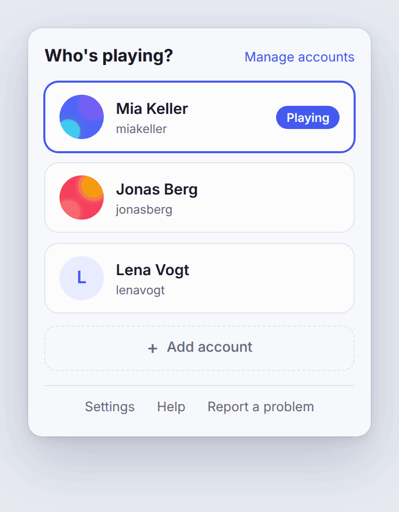
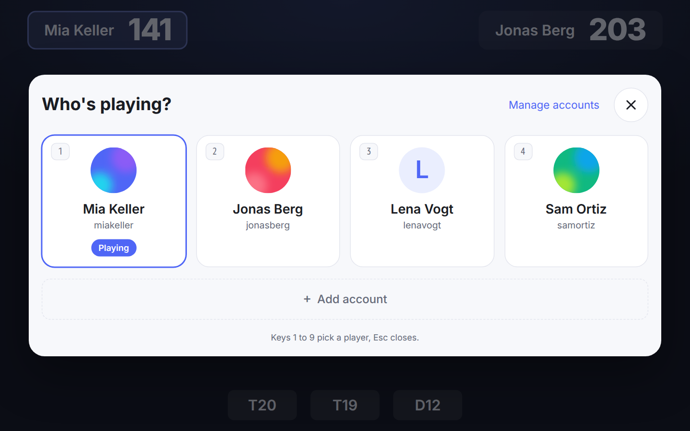
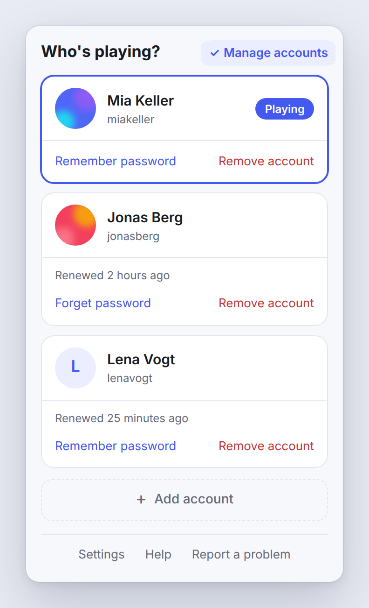

<div align="center">


# Player Switch for Autodarts

**One shared Autodarts display, everyone on their own account, one tap to switch.**

[](https://dennis-otto.github.io/player-switch-for-autodarts/)
[](https://github.com/Dennis-Otto/player-switch-for-autodarts/releases)
[](https://github.com/Dennis-Otto/player-switch-for-autodarts/actions/workflows/ci.yml)
[](https://github.com/Dennis-Otto/player-switch-for-autodarts/blob/main/CONTRIBUTING.md#tests)
[](https://github.com/Dennis-Otto/player-switch-for-autodarts/actions/workflows/codeql.yml)
[](https://github.com/Dennis-Otto/player-switch-for-autodarts/actions/workflows/secret-scan.yml)
[](https://github.com/Dennis-Otto/player-switch-for-autodarts/actions/workflows/sbom.yml)
[](https://scorecard.dev/viewer/?uri=github.com/Dennis-Otto/player-switch-for-autodarts)
[](https://api.reuse.software/info/github.com/Dennis-Otto/player-switch-for-autodarts)
[](https://github.com/sponsors/Dennis-Otto)

[**Documentation**](https://dennis-otto.github.io/player-switch-for-autodarts/) · [**Deutsche Anleitung**](https://dennis-otto.github.io/player-switch-for-autodarts/de/) · [Quick start](#quick-start) · [Help](https://dennis-otto.github.io/player-switch-for-autodarts/help.html) · [Changelog](https://github.com/Dennis-Otto/player-switch-for-autodarts/blob/main/CHANGELOG.md) · [💛 Sponsor](https://github.com/sponsors/Dennis-Otto)

<picture>
  <source media="(prefers-color-scheme: dark)" srcset="docs/images/switch.dark.gif">
  
</picture>

</div>

Every guide is on the [documentation website](https://dennis-otto.github.io/player-switch-for-autodarts/), in English and [German](https://dennis-otto.github.io/player-switch-for-autodarts/de/): the [help](https://dennis-otto.github.io/player-switch-for-autodarts/help.html), which explains every message of the extension, and the [guide for a shared display](https://dennis-otto.github.io/player-switch-for-autodarts/shared-display.html), with kiosk mode, the start with the computer and an on-screen keyboard.

<sub>💛 If Player Switch is useful to you, you can [support its development](https://github.com/sponsors/Dennis-Otto).</sub>

## Why

- **One tap, no typing.** The display in the hallway, the club or the pub is shared, but everyone plays under their own Autodarts account. A tap on a tile puts that account on the board.
- **Nobody gets signed out.** The account that steps aside keeps its session parked, so a tap brings it straight back. No password, no sign-in page.
- **Ready days later.** Autodarts rotates its session tokens; the extension renews every parked account in the background, so a saved account still works next week.
- **Made for the board display.** A round button on the Autodarts page and a keyboard shortcut open the players right over the page, also in fullscreen and in kiosk mode, where the toolbar of the browser is out of reach.
- **Ready for a club or pub.** An optional venue mode guards **Manage accounts** and the settings with a manager PIN, lets each player protect their account with a PIN of their own, and returns the display to a house account after a break, never during a match: [the venue mode](https://dennis-otto.github.io/player-switch-for-autodarts/shared-display.html#venue-mode).
- **For a keyboard, a screen reader and a finger.** The keys 1 to 9 pick a player, the focus keeps its place after every action, errors are read out at once, and every control is at least 44 by 44 pixels. A test checks the popup with axe-core for every change.
- **In five languages.** The popup, the players on the page, the welcome page and the settings speak English, German, Dutch, French and Spanish, in the language that Chrome runs in. The help and the website are in English and German.
- **Private by design.** Everything stays in the browser on that computer and goes only to Autodarts. No analytics, no server of ours, nothing sent anywhere else.
- **Removed means signed out.** **Remove account** ends the session of the account at Autodarts before it deletes it, so no copy of it keeps working, and **Forget all accounts** does so for every account and wipes the extension before a display changes hands: [the help](https://dennis-otto.github.io/player-switch-for-autodarts/help.html#forget-all).
- **No workaround needed.** No signing out and in for every player, no Chrome profile for each of them, no playing as a guest of someone else's account: [why not just …](https://dennis-otto.github.io/player-switch-for-autodarts/#why-not-just) says where each of them falls short.

## How it works

Autodarts Play keeps the signed-in session as a single value in the browser (a rotating refresh token in `localStorage`). The extension keeps that value per account and swaps it when you switch.

<picture>
  <source media="(prefers-color-scheme: dark)" srcset="docs/images/diagrams/switch-flow.dark.svg">
  
</picture>

- **Switching** parks the session of the account that was playing, writes the chosen account's session into the page and reloads.
- **The account that steps aside is not signed out at Autodarts.** Its session stays valid; "switching away" only takes it off the page.
- **Parked sessions are kept fresh.** Because the token rotates, the extension renews each parked account's token in the background, every 12 hours. Each time the browser starts, it checks that the renewal is still scheduled, and when the computer was off while a renewal was due, it renews straight away. "Manage accounts" shows for each parked account when it was last renewed, and since when renewing it fails while Autodarts can't be reached.
- **You see who needs attention.** When an account has to sign in again, the toolbar icon shows how many, and its tooltip names them, so nobody finds out only when they want to play. If Autodarts turns every saved account away at once, the popup says that Autodarts may have changed how it signs in and links to the known problems and updates.
- **One change at a time.** A token works only once, so a second tap while a switch is on its way is ignored, and the renewal in the background waits for the switch. A double tap can't sign the previous player out.
- **The tab in front.** A switch happens on the Autodarts tab you're looking at, and every other Autodarts tab reloads with the new player, so none plays on as the one before. With no Autodarts tab open, a tap opens Autodarts and switches there.
- **Updates need no reload.** Chrome updates an extension silently, and a page that was open before gets no new script by itself. The extension brings its script into the open Autodarts tabs after each install and update, and again into a tab that doesn't answer when you tap, so a display that keeps Autodarts open for days switches straight after an update, and a running match goes on.
- **A match ends only on purpose.** A switch reloads the page, so on the page of a running match the extension asks first, before it spends a token: "A match is running. Switching ends it on this display."
- **Password fallback, optional.** If you let the extension remember an account's password, it signs that account back in by itself should its token ever stop working. Accounts that sign in with Google or Apple can't use this.

Over days and weeks, a saved account moves between these states:

<picture>
  <source media="(prefers-color-scheme: dark)" srcset="docs/images/diagrams/account-states.dark.svg">
  
</picture>

[Decision 0002](docs/decisions/0002-swap-the-session-not-the-login.md) records why it works this way, and the [security design](docs/security.md) says what is stored and which risks remain.

## Quick start

### Install

**From the Chrome Web Store** — once the listing is live, install it in one click from its store page; updates then arrive on their own. The link goes here when it is. It needs Google Chrome 140 or newer, or a browser built on Chromium 140 or newer, such as Microsoft Edge.

**Unpacked, from the source:**

```sh
npm ci
npm run build
```

Then in Chrome open `chrome://extensions`, turn on **Developer mode**, choose **Load unpacked** and pick the `extension/` folder of this repository.

The extension asks only for access to `play.autodarts.com` and `api.autodarts.com`, its own storage, a timer for the renewal and the right to run its own script in the Autodarts tabs after an update, or in a tab where it stopped answering. It can't read the address or title of your other tabs, or your browsing history. Its content security policy lets it connect to `api.autodarts.com` alone, and the script that it runs in the Autodarts page can't read the saved accounts; the [security design](docs/security.md#trust-boundaries) has the details.

### Add the players

After the install, a welcome page opens with these steps:

1. **Pin the icon.** Chrome puts a new extension behind the puzzle piece next to the address bar: click it, then the pin next to Player Switch for Autodarts.
2. **Sign in the first player** on [play.autodarts.com](https://play.autodarts.com). The account is saved by itself, and the icon shows ✓ for a moment.
3. **Add the next players:** in the popup, or in the players on the Autodarts page, choose **Add account** and sign in as the next person. That account is saved by itself too, without opening the popup again.

From then on, a tap on a tile switches accounts, and **Manage accounts** shows the options of each account. The extension saves a new sign-in by itself only in the ten minutes after **Add account** or the install, and only once; **Cancel** in the popup or the switcher stops it earlier. A `+` on the icon says that someone is signed in who isn't saved, and **Save account** in the popup saves them.

<picture>
  <source media="(prefers-color-scheme: dark)" srcset="docs/images/diagrams/adding-a-player.dark.svg">
  
</picture>

The popup links to **Help**, the [help page](https://dennis-otto.github.io/player-switch-for-autodarts/help.html) of the website in the language of the browser, and to **Report a problem**, the bug form, filled in with the versions of the extension and the browser alone.

### Switch from the Autodarts page, also in fullscreen and kiosk mode

A board display often runs in fullscreen (F11) or as a kiosk (`chrome --kiosk`), where the toolbar and its popup are out of reach. So the Autodarts page itself carries a round button in a corner, with the picture of the player. A tap on it shows the players over the page, in large tiles for a touch screen, with everything the popup has: a tap on a tile switches, and **Manage accounts**, **Save account** and **Add account** are there too.

- **Keyboard:** <kbd>Alt</kbd>+<kbd>Shift</kbd>+<kbd>O</kbd> opens and closes the players on the page, <kbd>Alt</kbd>+<kbd>Shift</kbd>+<kbd>P</kbd> opens the popup. In the players, the keys <kbd>1</kbd> to <kbd>9</kbd> pick a player and <kbd>Esc</kbd> closes them. Chrome lets you change both shortcuts under `chrome://extensions/shortcuts`.
- **Settings:** **Settings** in the popup, or **Details → Extension options** under `chrome://extensions`, turns the button off or moves it to another corner. The shortcut works with the button off as well.
- **Private:** the players open in a page of the extension, in a frame of its own, so the scripts of the Autodarts page can't read the saved accounts.

The [guide for a shared display](https://dennis-otto.github.io/player-switch-for-autodarts/shared-display.html) sets up kiosk mode, the start with the computer on Windows and on a Raspberry Pi, an on-screen keyboard for the sign-ins and the power settings that keep every account ready.

<picture>
  <source media="(prefers-color-scheme: dark)" srcset="docs/images/switcher.dark.png">
  
</picture>

<picture>
  <source media="(prefers-color-scheme: dark)" srcset="docs/images/diagrams/switch-from-the-page.dark.svg">
  
</picture>

### Remember a password (optional)

Under **Manage accounts**, choose **Remember password** for an account, and the extension signs it back in on its own if its session ever stops working. The password stays on that computer, encrypted like every saved session, and is sent only to Autodarts; [SECURITY.md](SECURITY.md) and the [privacy policy](docs/privacy.md) say exactly what is stored.

<picture>
  <source media="(prefers-color-scheme: dark)" srcset="docs/images/manage.dark.png">
  
</picture>

## Good to know

- The way the extension keeps a session is not an official Autodarts interface. A change on Autodarts' side can stop it until the extension is adjusted, and how long a parked token stays valid is up to Autodarts. When Autodarts turns every saved account away in one renewal, the popup tells you to look for an update of the extension rather than sign everyone in again.
- It is built for a display that the people of a household, club or venue share and trust: anyone at that display can switch to any saved account, which is the point. Where not everyone knows everyone, the [venue mode](https://dennis-otto.github.io/player-switch-for-autodarts/shared-display.html#venue-mode) adds PINs and a return to a house account after a break. A PIN is a lock for the people at the display, not a protection against someone who can use the computer; the extension keeps only a salted hash of it.
- The saved accounts carry the version of their format. Going back to an older version of the extension never wipes accounts that a newer one saved: the older one leaves them untouched, keeps a copy, and the popup asks you to update.
- Something doesn't work? The [help](https://dennis-otto.github.io/player-switch-for-autodarts/help.html) explains every message of the extension and what to do about it.

## Development

Contributions are welcome. [CONTRIBUTING.md](CONTRIBUTING.md) has the rules and the checks, [docs/development.md](docs/development.md) explains how the code is laid out, how to run the extension from the source and what the tests check, among them property-based tests that run the account logic on generated inputs and end-to-end tests that run the built extension in a real Chromium against a fake Autodarts, and checks that warn before a change of Autodarts or the next version of Chrome breaks the extension, and [docs/releases.md](docs/releases.md) how a release reaches the Chrome Web Store. A translation into another language is welcome: [Add a language](docs/development.md#add-a-language) says what it takes.

## Support and security

Questions and problems: see [SUPPORT.md](SUPPORT.md). Report vulnerabilities privately, as [SECURITY.md](SECURITY.md) describes.

## License

MIT; see [LICENSE](LICENSE). Every file names its license in the machine-readable form of [REUSE](https://reuse.software). Not affiliated with Autodarts.
