# Development

How the code is laid out, how to run the extension from the source, and what the checks look at. [CONTRIBUTING](https://github.com/Dennis-Otto/player-switch-for-autodarts/blob/main/CONTRIBUTING.md) has the rules for changes.

## How the code is laid out

| Where | What |
| --- | --- |
| `src/` | The account logic, in TypeScript, without the browser: `autodarts.ts` talks to Autodarts' sign-in service (renew, sign in, end a session, read who a session belongs to), `state.ts` keeps the saved accounts and which one plays, `storage.ts` stores them with the version of their format, `vault.ts` seals their sessions and passwords with a key that can't be exported, kept in the IndexedDB of the extension, `switch.ts` is the switch itself, with the page, the storage, the clock, `fetch` and the queue passed in, `queue.ts` the queue that runs one change of the accounts at a time, `tabs.ts` finds the Autodarts tab that a switch talks to, reloads the others and opens Autodarts when no tab is open, `health.ts` decides when the renewal runs and what the toolbar badge and the popup say about it, `page.ts` the decisions of the switcher in the page: its settings, what its button shows, whether a match runs in the page and which tile a key picks, `onboarding.ts` when the welcome page opens and what the bug report carries, `trust.ts` who may reach the accounts: which sender may send which request, and that the content scripts can't read the storage, and `venue.ts` the venue mode for a club or pub: the PINs, kept as salted PBKDF2 hashes, the count of wrong PINs, and when a break on the display is over and where it returns to, never during a match. The code that runs in the browser is TypeScript as well: `worker.ts` is the service worker, which wires the browser to the logic through `ChromeApi`, a typed port of the members of `chrome` that it uses, and `background.ts` starts it on the real `chrome`; `messages.ts` holds the types of every [message](#the-messages) between the pages, the worker and the content script, and `readRequest`, with which the worker reads each one it receives; `content.ts` runs in the Autodarts page, is the only code that reads or writes the page's stored session and shows the button and the frame of the switcher there; `popup-model.ts` and `options-model.ts` hold what the popup, the switcher and the options page decide, such as what the status line says, which question an answer asks of the person and what a tile shows; and `pages/` holds the code of the pages, which only draws and sends: `players.ts` shows the players and their accounts for both the popup (`popup.ts`) and the switcher in the page (`switcher.ts`), `dialogs.ts` asks to confirm or for a PIN, `options.ts` is the options page, `welcome.ts` the welcome page of the install, and `support.ts` points the links to the help and to a bug report. Every line, branch and function of `src/` outside `pages/` runs in a test; the pages run in the [end-to-end tests](#end-to-end-tests) and the [check of the accessibility](#checks). |
| `test/` | The tests of `src/`, with fakes for the page, the tabs of the browser, the storage and Autodarts, and in `store-kind.test.ts` those of what keeps the repository a Chrome extension of the blueprint: `browser.ts` is a fake browser for the service worker, and `content.test.ts` runs the content script as Chrome does, as a classic script in a world of its own beside an Autodarts page of [happy-dom](https://github.com/capricorn86/happy-dom). The `*.property.test.ts` files are [property-based tests](#property-based-tests), which run the code on many generated inputs. `test/e2e/` holds the [end-to-end tests](#end-to-end-tests), which run the built extension in a real Chromium against a fake Autodarts. `test/harness/` is the stage of the [pictures](#pictures) and of the [accessibility test](#checks): the real popup and switcher with a stand-in for Chrome. |
| `extension/` | The loadable extension, Manifest V3, and no code of its own: the manifest, the pages with their styles (`popup.html`, `switcher.html`, `options.html` and `welcome.html`), the icons and `_locales/` with the texts in English, German, Dutch, French and Spanish ([Add a language](#add-a-language)). `extension/lib/` is built from `src/` and not committed: the manifest names `lib/background.js` as the service worker and `lib/content.js` as the content script, and each page loads its script from `lib/pages/`. |
| `store/` | The texts of the Chrome Web Store listing, `pictures.<code>.json` the texts on its pictures, in `store/images/` the pictures themselves, and `permissions.json`, every permission, host and web-accessible page that the manifest may ask for, each with its reason. |
| `scripts/` | `check.sh` runs every check, `check-project.sh` the ones of this project (every language against English and against the texts that the pages use, the files the manifest names and the scripts that the pages load, and the template of a tile in the switcher against the popup's, the help, which must quote every message that reports a problem, in English and German, and to which **Help** must lead in every language: `check-help.mjs`, and [what the manifest may ask for](#what-the-extension-may-do): `check-extension.mjs`, with its self-test `check-extension.test.mjs`, and last the popup in a browser: `test/harness/a11y.mjs`), and `screenshots.sh` renders the [pictures](#pictures). The blueprint keeps the scripts of the kind *Chrome extension*: `check-manifest.mjs` checks the manifest against what the store refuses or holds up, `package-extension.sh` builds the zip of a release, `load-extension.mjs` starts the extension in Chrome for Testing in the CI, and `store-status.mjs` decides in the daily run of the store workflow whether a release goes to the store ([Releases](releases.md#later-versions)). |

<picture>
  <source media="(prefers-color-scheme: dark)" srcset="images/diagrams/architecture.dark.svg">
  
</picture>

The one rule that shapes `switch.ts`: Autodarts rotates the refresh token, so the token in the page belongs to the page. The extension reads it only to park it when switching away, writes a token only when a different account takes over, and never renews the token that is live in the page behind the page's back. It renews that token only when it leaves the page anyway, to learn whose session it is, since someone may have signed in as another account right in the page, or when a person saves the session, and the fresh token then goes straight back. [Decision 0002](decisions/0002-swap-the-session-not-the-login.md) records why, and the [security design](security.md) what is stored.

### One change of the accounts at a time

Because a token works only once, two changes of the accounts must never run side by side: both would load the same accounts and spend the same token, and the one that saves last would write the accounts it loaded over the work of the other. So every operation of `switch.ts` that reads or changes the accounts, a switch, a sign-out, the claim of a session, a remembered password and the view of the popup, waits for its turn in the queue of `deps.queue`, and loads the accounts only when its turn has come. The renewal in the background takes one turn per parked account, so a tap waits for one renewal at most, and saves each fresh token as soon as it arrives. A second tap on the player who is coming on finds them playing when its turn comes, and spends no token. All of it runs in the one service worker, so a chain of promises there is the whole lock; the popup on its side takes no tap while a request runs.

<picture>
  <source media="(prefers-color-scheme: dark)" srcset="images/diagrams/one-change-at-a-time.dark.svg">
  
</picture>

The tests in `test/switch.test.ts` run these races against a fake Autodarts that rotates every token it renews and refuses a token that comes back, and `test/switch.property.test.ts` lets taps, double taps, the claim of a session, a sign-out and the renewal overlap in any order that the scheduler of fast-check picks for the answers of Autodarts and the page. A second test runs the same property without the queue and must find an order that sends a token twice, so the first one can't pass by missing the race.

### The saved accounts keep their format

The accounts are one value in `chrome.storage.local`, `{ version: 2, profiles, activeId, addingUntil }`. A parked token that is lost can't be made again, so `storage.ts` never saves over a value that this version doesn't read: one of a newer version, after going back to an older extension, or one that is no state at all. It keeps a copy of such a value under `accounts.backup`, which it deletes as soon as the stored value is one it reads again (so a removed account leaves no token or password behind in it), every reading and change of the accounts fails with `UnknownStateError`, and the popup says that the accounts come from a newer version and asks for an update. `test/storage.test.ts` runs this against a storage that keeps JSON, and `test/state.property.test.ts` checks that no value of another version is ever taken for accounts.

### The sessions and passwords are sealed

In version 2 of the format, the `token` and the `credentials` of each account are sealed, `{ iv, data }`, and everything else stays plain, so that the button in the page can show the player without opening a secret (`accountsIn`). `vault.ts` seals each with AES-GCM under one key of 256 bits, with a random nonce of 12 bytes per sealing, and with the place of the secret, `token/<id>` or `credentials/<id>`, as the additional data, so that a value moved to another account doesn't open. The key is a `CryptoKey` that can't be exported, made at the first use and kept in the IndexedDB of the extension (the database `vault`, the table `keys`), which neither a content script nor a page of another origin reaches; `keyStoreIn` stores it only where none is stored yet, so a key that sealed the accounts is never replaced.

- **The format before** is version 1: the same fields with the secrets in plain text, as the releases up to 0.2.0 stored them without a version and the versions after them with `version: 1`. `readStored` of `state.ts` reads it as `plain`, and the store seals it at the first reading, and on the update of the extension in `onInstalled`.
- **A secret that doesn't open,** because the key is gone, for example after the data of the extension was cleared, or because the value was changed, is gone: a lost session ends the session of the account (`endSession`), so it has to sign in again, and a lost password is forgotten. The store saves the accounts so at once. A key store that fails, though, fails the reading, and nothing is saved, so a passing fault never costs a session.
- **A reading may save.** Every reading of the accounts runs in the queue of `switch.ts`, so the store may save the sealed accounts there without racing another change.

`test/vault.test.ts` runs the vault with WebCrypto in Node and the key store against `fake-indexeddb`, an IndexedDB in memory; `test/storage.test.ts` checks that no token or password of the fixtures is left in the storage after the migration, that a lost key ends the sessions and forgets the passwords without a failure, and that a moved value doesn't open; and `test/state.property.test.ts` lets the store save and load accounts of every generated history with the real encryption.

### The switcher in the page

On a display in fullscreen or kiosk mode the popup is out of reach, so the content script, `content.ts`, puts a button into the Autodarts page and, on a tap or the shortcut `toggle-switcher`, lays `switcher.html` over the page in a frame. Three rules shape it:

- **The page never sees an account.** The frame is a page of the extension, of another origin than Autodarts, so the scripts of the page can't read into it; the button and the frame sit in a closed shadow root. Only `switcher.html` is a web-accessible resource, and only for `play.autodarts.com`. The content script itself learns no more than the player on the button: it asks the service worker with `{ type: "button" }`, and it can't read the storage, which the service worker keeps to the extension's own contexts.
- **One way to the accounts.** The switcher sends the service worker the same requests as the popup, through the same `pages/players.ts`, so a fix of one is a fix of both. It asks the worker to close it (`{ type: "switcher", action: "close" }`), and the worker tells the content script of the tab it came from.
- **A match ends only on purpose.** A switch or a sign-out on a match page answers `{ ok: false, reason: "match" }` and spends no token; the popup or the switcher asks the person, and sends the request again with `confirmed: true` on a yes. `mustConfirm` in `src/page.ts` decides it from the address of each Autodarts tab.
- **One tab per request.** The worker picks the tab of a request once and sends the switch to it first: the tab of the switcher where the person tapped, or for the toolbar popup the Autodarts tab that `tabs.ts` puts in front. The other Autodarts tabs reload after the switch, as [the next section](#which-tab-a-switch-talks-to) explains, so the check for a match looks at every Autodarts tab.
- **An update keeps the button.** Chrome runs a content script only in pages that load after an install or an update, and the script of the version before loses its link to the extension. So `injectAll` of `tabs.ts` runs the content script, `lib/content.js`, again in the open Autodarts tabs with `chrome.scripting` when the extension is installed or updated, and `reach` runs it in a tab whose content script doesn't answer a request, before it sends the request once more: a tab that the install or update missed, such as one that Chrome had discarded, or one that was open while the extension was turned off and on again, answers at the next tap or keyboard shortcut. The new script removes the button of the old one and makes the page usable again where the old switcher had made it inert, without a reload, so a running match goes on. A tap on the button of a script that was cut off reloads the page, and asks first on a match page.

### What the extension may do

The extension holds the sessions and the remembered passwords of every player, so it asks the browser for as little as it can, and the browser enforces each limit:

- **The permissions.** `storage`, `alarms`, `scripting` and `unlimitedStorage` (so that Chrome never evicts the IndexedDB that holds the key of `vault.ts`), and access to `play.autodarts.com` and `api.autodarts.com`, nothing else: no `tabs`, which would show "Read your browsing history" at the install. `play.autodarts.io` forwards every address to `play.autodarts.com`, so no page of it ever shows, and the extension asks for no access to it.
- **The storage.** Chrome lets the content scripts of an extension read `chrome.storage.local` unless the extension says otherwise. So `worker.ts` calls `keepFromContentScripts` of `trust.ts` at each start of the service worker, which sets the access level of the storage to `TRUSTED_CONTEXTS`: the service worker, the popup, the options page and the switcher in its frame read it, the content script in the Autodarts page doesn't.
- **The messages.** The service worker takes a message only from this extension, and a request to see or change the accounts only from one of its pages, by the id and the address of the sender (`fromExtensionPage` of `trust.ts`); the content script may only ask what its button shows and, while the venue mode returns the display after a break, say that someone used the page. Every PIN of the venue mode is checked in the service worker, for a switch and for a change of the accounts alike, so no view can go around it. The content script takes messages only from this extension, and writes only a token into the session of the page. [The messages](#the-messages) shows each of them.
- **The content security policy** of the pages and the service worker, in the manifest: `default-src 'self'; script-src 'self'; object-src 'none'; base-uri 'none'; form-action 'none'; img-src 'self' https: data:; connect-src https://api.autodarts.com`. The extension runs only its own scripts, connects to the sign-in service of Autodarts alone, and loads the pictures of the players from wherever Autodarts keeps them.
- **The browser.** `minimum_chrome_version` is 140, the first version in which `chrome.storage.local.setAccessLevel` works; before it, Chrome refuses the call outside `chrome.storage.session`, and the content script could read every saved account. `scripts/check-manifest.mjs` fails on a lower one. The rest of the code needs Chrome 120 (`URL.canParse`, which `page.ts` uses) and older. Raise it with the first feature that needs a newer one, and say so in the help.

`scripts/check-extension.mjs` keeps it that way, on top of `scripts/check-manifest.mjs` of the blueprint, and fails `scripts/check.sh` when the manifest asks for a permission, a host or a web-accessible page that `store/permissions.json` doesn't allow, when an entry there is no longer used, or when a store listing doesn't justify exactly what the manifest asks for. Chrome disables an installed extension after an update that asks for more, until someone accepts the new warning in `chrome://extensions`, and a board display in kiosk mode would stop switching without a word. It also refuses `externally_connectable`, optional permissions, `sandbox`, `update_url`, a content script in the world of the page and a content security policy that runs scripts from elsewhere or connects to a host the manifest has no access to, and it checks the minimum version of Chrome, the homepage, the sizes of the icons and the lengths that the store allows for the name and the descriptions in every language. To add a permission, add it to the manifest and to `store/permissions.json` with its reason, justify it in every store listing, a host as the manifest names it, such as `https://play.autodarts.com/*`, and say in the changelog that the update asks for it. `scripts/check-extension.test.mjs` tests the checker with fixture manifests that each break one rule.

### The messages

The pages of the extension, the service worker and the content script talk only through messages, and each one has one type in `messages.ts`, which all three share: a renamed action or a missing field fails the type check, not a tap on the display. The service worker reads each message with `readRequest` before it acts and answers none of a shape that it doesn't know; `trust.ts` decides who may send which. The content script can't import a module, so it takes the types alone, which the compiler leaves out of the script it writes.

<picture>
  <source media="(prefers-color-scheme: dark)" srcset="images/diagrams/the-messages.dark.svg">
  
</picture>

A request of the popup that a PIN guards, or that would end a match, comes back with `ok: false` and the `reason` (`pin`, `locked` or `match`), and the popup asks the person and sends it again with the answer: `pin`, `managerPin` or `confirmed`. Every answer of the worker carries the view to draw.

### Which tab a switch talks to

Every Autodarts tab of the browser shares one `localStorage`, and with it one session. So `tabs.ts` sends a switch to the tab that the person is looking at: the one shown in the window used last, then one shown in another window, such as the board display beside a laptop, then the one shown most recently. A tab whose content script doesn't answer, as one that was open before the extension was installed or updated, first gets the content script of this version and the request once more; only a tab that doesn't answer even then, as one that Chrome discarded, passes the request on to the next. Once the session in the page has changed, every other Autodarts tab reloads, so none plays on as the account before and spends its token when it renews its session. The tabs reload one after another, each once the one before has renewed the new session: every page that starts sends the token it finds in `localStorage`, and two that started together would send the same one, which Autodarts takes for a stolen token and answers by ending the new player's session.

With no tab that answers even so, a tap still works: the extension reloads the tab in front, or opens Autodarts behind the popup when no tab is open, and switches there once the page is ready. Autodarts renews its session as it starts, which spends the token in `localStorage`; so the extension first waits until the page has done that, and parks the fresh token of the player before, not the spent one. A switch that worked brings the tab it opened to the front; after one that failed, the popup stays open with the reason.

<picture>
  <source media="(prefers-color-scheme: dark)" srcset="images/diagrams/which-tab.dark.svg">
  
</picture>

The extension finds the Autodarts tabs through its access to the Autodarts sites, which lets the browser filter the tabs by their address. It asks for no `tabs` permission, which would show the warning "Read your browsing history" at the install and let it read the address of every tab. The tests in `test/tabs.test.ts` run it against a fake browser whose Autodarts tabs share one session, load for a while and renew their session as they start.

### The renewal keeps going

Chrome [may clear an alarm when the browser restarts](https://developer.chrome.com/docs/extensions/reference/api/alarms), and a display that is switched off at night misses the renewal that was due. So `worker.ts` doesn't rely on the alarm alone: each start of the service worker asks `planStart` of `health.ts` what to do, with the alarm, the record of the last renewal and the clock. A missing alarm is set again for the time the next run is due, and a renewal that is a period overdue, or that never ran, runs straight away. `chrome.runtime.onStartup` and `onInstalled` wake the service worker for it, and the run that the alarm starts and the one of a start share one turn.

An account that Autodarts can't be reached for keeps its session and records in `renewalFailedAt` when the failures began; "Manage accounts" shows "Renewal failing since …" until a renewal works again, and the service worker writes every failure to its console in `chrome://extensions` instead of dropping it. Each run records its time only when Autodarts answered for every parked account, so a start without a network catches up at the next start, and it sets the next run 15 minutes later in that case, 12 hours later otherwise. The time of every attempt is kept as well, and a start does not catch up when the last attempt is less than 15 minutes ago, so an account that Autodarts keeps failing for does not renew everyone at each wake-up of the service worker; the retry alarm comes instead. Names and times on the badge and in the popup use the language of the extension's texts, not the browser's, so a line never mixes two languages. When one run turns away every parked account, at least two, the record keeps that as a suspected change at Autodarts, and the popup suggests an update of the extension while an account still has to sign in again; a run that renews an account clears it. The toolbar badge follows every change of the saved accounts and counts those that have to sign in again. Each of these decisions is a function of `health.ts` with the clock passed in, and `test/health.test.ts` runs them with a clock that stands still.

<picture>
  <source media="(prefers-color-scheme: dark)" srcset="images/diagrams/how-the-renewal-keeps-going.dark.svg">
  
</picture>

### A new player is saved by itself

**Add account** signs the page out and opens a window of ten minutes, `addingUntil` in the saved accounts; so does the install, which also opens the welcome page, once, and not after an update. Each time an Autodarts tab has finished loading, `worker.ts` asks `adoptNewSignIn` of `switch.ts`, a few times over 15 seconds, because Autodarts stores the session a moment after the load; the popup and the switcher on the page ask it as well when they open. Within the window, the first session in the page is saved, as **Save account** saves it, the window closes, and the badge shows a check mark for four seconds. Outside it, `adoptNewSignIn` changes nothing and spends no token, and a window that ran out is closed for good, so a sign-in later on is never saved by itself. A player who comes on closes it as well: `activate` of `state.ts` ends the window, so it is open only while no saved account plays. The badge shows `+` while the page holds a session that no account keeps, and the count of the accounts that have to sign in again otherwise. `test/switch.test.ts` runs the window with a clock that the test sets, also two loads of the page at once, and the model test lets time pass and pages load at any step of an evening. [Decision 0004](decisions/0004-save-a-new-sign-in-only-in-a-window.md) records why the window is there.

## Run it from the source

```sh
npm ci
npm run build
```

Then in Chrome open `chrome://extensions`, turn on **Developer mode**, choose **Load unpacked** and pick the `extension/` folder. After a change, build again and reload the extension there; a change of `content.ts` also needs a reload of the Autodarts tab.

In Edge, the same: `edge://extensions`, **Developer mode**, **Load unpacked**. In Firefox, open `about:debugging#/runtime/this-firefox`, choose **Load Temporary Add-on…** and pick `extension/manifest.json`; **Reload** there loads a change, and Firefox removes the add-on when it closes.

## Firefox and Edge {#firefox-and-edge}

One package runs in Chrome, Edge and Firefox, as [decision 0012](decisions/0012-run-one-package-in-chrome-edge-and-firefox.md) records. Edge is built on Chromium and runs it as Chrome does. Firefox runs `background.js` from `background.scripts`, as an event page, where Chrome and Edge run it as a service worker, and takes the id of the add-on, the oldest Firefox and the data that the add-on sends from `browser_specific_settings.gecko`:

<picture>
  <source media="(prefers-color-scheme: dark)" srcset="images/diagrams/one-package-every-browser.dark.svg">
  
</picture>

`scripts/check-extension.mjs` fails when `background.scripts` and `background.service_worker` name another file than the one `background.js`, when the id of the add-on changes, when the manifest names a Firefox older than 140 or a Firefox for Android older than 142, the first ones that show the data at the install, or when `data_collection_permissions` declares other data than `store/permissions.json`. `scripts/check-firefox.mjs` lints `extension/` with [addons-linter](https://github.com/mozilla/addons-linter), the linter of addons.mozilla.org that `web-ext lint` runs, pinned in `package.json`; it fails on every error, and on every warning that its list `ACCEPTED` doesn't explain with a reason.

The interfaces that the extension uses, and the first Firefox that has each, from the compatibility data of MDN that addons-linter carries:

| Interface | Firefox |
| --- | --- |
| `storage.local`, `tabs.query` with `url`, `tabs.create`, `tabs.update`, `tabs.reload`, `windows`, `runtime`, `i18n`, `commands`, IndexedDB and WebCrypto | 45 to 52 |
| `scripting.executeScript` | 102 |
| `action.setBadgeTextColor` | 109 |
| ES modules in the background (`"type": "module"`) | 112 |
| `storage.session` | 115 |
| `background.scripts` beside `background.service_worker` | 121 |
| `commands.openShortcutSettings` | 137 |
| `data_collection_permissions`, shown at the install | 140 |
| `storage.local.setAccessLevel` | none |

Four things work differently, and the code allows for each:

- **The address of the pages.** Firefox serves the pages of an add-on from `moz-extension://<uuid>/`, with a random host for each installation, not from `chrome-extension://<id>/`. `fromExtensionPage` in `src/trust.ts` compares the address of a sender with `chrome.runtime.getURL("")`, the address of the extension's own pages, in every browser.
- **The storage is open to the content script.** Firefox has no `storage.local.setAccessLevel`, so it can't keep the storage from `content.js`. The sessions and passwords in it are sealed all the same, but the rest is in reach of a page whose process is taken over; the service worker writes "keeping the saved accounts from the Autodarts page failed" to its console at each start, and [the security design](security.md#firefox) says what that means.
- **The page of the shortcuts.** Firefox opens no `chrome:` address in a tab, so **Change shortcuts** on the options page calls `commands.openShortcutSettings` where the browser has it, and opens `chrome://extensions/shortcuts` in Chrome and Edge otherwise (`openShortcuts` in `src/page.ts`).
- **The name of the browser.** Firefox has no `navigator.userAgentData`, so the bug form takes "Firefox 144" from its user agent (`browserName` in `src/onboarding.ts`).

The [end-to-end tests](#end-to-end-tests) run in Chromium alone, because Playwright loads no extension into Firefox. So check a release in Firefox by hand, with test accounts of Autodarts, never the real one of a player:

1. `npm ci --ignore-scripts && npm run build`, then load `extension/manifest.json` as a temporary add-on, as above. Its page in `about:addons` lists the access to the Autodarts sites, which has to be allowed, and the data that the add-on sends.
2. Open [play.autodarts.com](https://play.autodarts.com) and sign in as the first test account: the icon shows ✓ and the popup lists it.
3. **Add account**, sign in as the second test account, then tap the first one in the popup, and once more in the players on the page (<kbd>Alt</kbd>+<kbd>Shift</kbd>+<kbd>O</kbd>): the page shows the player that was tapped, without a sign-in.
4. **Inspect** next to the add-on in `about:debugging` opens the console of the background: it shows the line about the storage and no other error.
5. **Remove account** for both test accounts.

In Edge, load `extension/` unpacked and follow steps 2, 3 and 5; its console is under **service worker** in `edge://extensions`.

## Pictures

Every picture of the extension in the README, on this website and in the Chrome Web Store comes from its real pages, rendered by a script, so a change of the popup never leaves an old picture behind:

```sh
bash scripts/screenshots.sh
```

It needs Docker and Node. It builds `extension/lib/` from `src/`, then the headless Chromium of the pinned Playwright image opens `test/harness/stage.html`, which shows the real `popup.html` or `switcher.html` in a frame. `test/harness/chrome-stub.js` stands in for Chrome there: it reads the texts of `extension/_locales/` and answers the requests of `pages/players.ts` as the service worker does, with four made-up accounts and generated pictures, no real people. `test/harness/capture.py` takes each picture at a fixed size, scale, color scheme and language, with the Inter font and no network, so two runs give the same pixels:

- `docs/images/switch.gif`: a tap that switches players, for the README, with `switch.mp4` and its first frame `switch.webp` beside it, which the home page shows in its place as a video that the reader can pause and that stays still for one who asks for less motion; `manage.png`: **Manage accounts**; `switcher.png`: the switcher over a match on a board display. Each also `.dark`, for a dark theme, and in German, `.de` and `.de.dark`.
- `docs/images/load-unpacked.png`: the top of `chrome://extensions`, the one picture of a page of the browser itself, from the whole Chromium of the image, with Developer mode on and what [the install from a release](index.md#install-from-a-release) asks for marked, also `.dark` and in German;
- `store/images/`: the screenshots and the promo tiles of the store, in every language of `extension/_locales/` (`.en`, `.de`, `.nl`, `.fr` and `.es`), with the text around the extension from `store/pictures.<code>.json`; [the release guide](releases.md#the-images-of-the-store) says where each goes. A text that doesn't fit its picture stops the script with the address of the picture, so a translation never gets cut off.

<picture>
  <source media="(prefers-color-scheme: dark)" srcset="images/diagrams/how-the-pictures-are-made.dark.svg">
  
</picture>

After a change of `main` that touches a file of `.github/screenshots-paths.txt`, such as the popup, its texts, the texts on the pictures of the store or the harness, after every release and every week, the screenshot bot runs the script and opens a pull request with the pictures whose pixels changed. To see what a change of yours changes, run the script and then `python3 .github/blueprint.py screenshots restore`, which gives every picture that looks the same its committed file back.

The stage works without the script too, for a look at the popup in a plain browser or for a test of it: a driver loads `chrome-stub.js` before the scripts of each page, as Playwright's `add_init_script()` does, serves the repository and opens `test/harness/stage.html?layout=frame&lang=de`, or `extension/popup.html?lang=de&accounts=2` alone. `window.harness.hold()` keeps the next request of the popup waiting until `harness.release()`, to catch a moment such as "Switching to …", and `harness.refuse({ ok: false, reason: "unreachable" })` answers the next one as the worker refuses it, to show an error. The [accessibility test](#checks) drives the popup this way.

## Add a language

The extension speaks English, German, Dutch, French and Spanish. Chrome gives it the texts of the language that Chrome itself runs in, and English, the `default_locale` of the manifest, for any other; names and times on the badge and in the popup follow the message `locale` of those texts, so a line never mixes two languages. The website, and with it the help, is in English and German: **Help** in Dutch, French or Spanish leads to the English help.

<picture>
  <source media="(prefers-color-scheme: dark)" srcset="images/diagrams/which-language.dark.svg">
  
</picture>

A better word in a translation is welcome as a pull request that changes only its `messages.json`. To add a language, such as Italian (`it`):

1. **The texts:** copy `extension/_locales/en/messages.json` to `extension/_locales/it/messages.json` and translate every `message`. Keep each placeholder such as `$NAME$` with its `placeholders` as in English, set `locale` to the code of the folder, `it`, and leave `helpUrl` at the English help unless the website has the help in Italian. `pinPictureMenu` is the heading of the list of extensions in Chrome, as Chrome names it in Italian. A description for the translator, such as that of `locale`, may stay in English.
2. **The store listing:** copy `store/listing.en.md` to `store/listing.it.md` and translate it. Its short description is `extDescription`, at most 132 characters. Leave the headings `## Short description` and `## Permission justifications` in English: the checks find these sections by them.
3. **The pictures of the store:** copy `store/pictures.en.json` to `store/pictures.it.json` and translate its texts, the words around the extension in the [pictures](#pictures), and in every `pictures.*.json` change the number of languages that the second slide names, which `scripts/check-manifest.mjs` compares with the folders of `extension/_locales/`. `bash scripts/screenshots.sh` renders `store/images/*.it.png` from every folder of `extension/_locales/`, and stops at a text too long for its picture; without Docker, the screenshot bot renders them after the merge.
4. **The test in a browser:** add the code to `LANGUAGES` in `test/harness/chrome-stub.js`, the stand-in for Chrome, and `test/harness/a11y.mjs` checks the popup in Italian too, with axe-core and for button texts that break.
5. **The documents:** add the language to the lists in `README.md`, `docs/index.md` and `docs/index.de.md`, its pictures to the table of [the images of the store](releases.md#the-images-of-the-store), and a line to the changelog in `changelog.d/`.

`bash scripts/check-project.sh` then says what is still missing:

- `scripts/check-locales.mjs`, tested in `test/check-locales.test.ts`, compares every language with English: a message that is missing, one that English doesn't have, one without a text, a placeholder that a translation drops, renames or defines with another value, a `locale` that doesn't name its folder, and a folder that Chrome reads as no language, such as `it-IT` for `it_IT`;
- `scripts/check-extension.mjs` fails on a name of more than 75 or a description of more than 132 characters in any language, on a language without a store listing and on a listing without a language, on a language without `store/pictures.<code>.json` or with other texts there than in English, on a picture in `store/images/` of a language that the extension doesn't speak, and on a language whose pictures `docs/releases.md` doesn't list;
- `scripts/check-help.mjs` checks that **Help** leads to the help in that language, or to the English help where the website has none in it;
- `test/harness/a11y.mjs` fails when the stand-in for Chrome shows the language in English, because it is missing from `LANGUAGES`.

## Checks

```sh
bash scripts/check.sh
```

runs what the CI runs: the text files, the version in every file, the shell scripts, the types, the tests with full coverage, the package, and the checks of this project. The type check covers every line that ships, and the tests every line, branch and function of `src/` but the pages:

- **The service worker** (`test/worker.test.ts`) runs on `test/browser.ts`, a fake of the members of `chrome` in `ChromeApi`, whose Autodarts tabs share one session as the tabs of one site do, with the fake Autodarts of `test/helpers.ts` that rotates every token, an IndexedDB in memory, and a clock and timers that the test moves. Each test fires the events of the browser, a message, an alarm, a loaded tab, an install, and checks what the worker did: the accounts, the badge, the alarms, what it told the tabs and the traces in its console.
- **The content script** (`test/content.test.ts`) runs as Chrome runs it: `stripTypeScriptTypes` of Node turns `src/content.ts` into JavaScript, and `vm` runs it as a classic script, in a world of its own beside an Autodarts page of happy-dom, with a fake `chrome`, so a script that imports or exports anything fails there. A second run in the same world is a second injection into the same tab, as after an update. The key under which it keeps the session is checked against `SESSION_KEY` of `autodarts.ts`.
- **The messages** (`test/messages.test.ts`): `readRequest` takes each request that a page or the content script sends, and nothing of another shape.
- **The pages** decide nothing themselves: what they show and ask is in `popup-model.ts` and `options-model.ts`, which their tests check with every answer of the worker. The pages draw it, and the [end-to-end tests](#end-to-end-tests) and the check of the accessibility below run them in a real browser.

The checks of this project, `scripts/check-project.sh`, compare the manifest with the release, every language with English and English with what the code asks for, and the texts and `aria-label`s that the pages carry themselves with their English messages (`scripts/check-locales.mjs`, tested in `test/check-locales.test.ts`), and lint the package for Firefox with addons-linter ([Firefox and Edge](#firefox-and-edge)). Last, `test/harness/a11y.mjs` opens the real popup and switcher on the [stage of the pictures](#pictures), in the Chrome or Edge of the computer through `playwright-core`, and checks:

- **axe-core,** with the rules of WCAG 2.2 up to AA and its best practices, in the list, an error, **Manage accounts**, the form of a remembered password, the question before ending a match and the question before a removal, in every language of the extension, light and dark, and the switcher;
- **the sizes:** every control at least 44 by 44 pixels, no text smaller than 12 pixels and no button text that breaks onto a second line, as long German or French words would;
- **the focus,** in a walk with the keyboard alone through every action: the keys 1 to 9, a switch, an error, **Manage accounts**, a remembered and a forgotten password, a removal and **Add account** with its **Cancel**;
- **the system:** a contrast theme keeps the player who plays apart, and reduced motion leaves no transition.

```sh
npm run test:a11y
```

runs it alone, after a build of `extension/lib/`. `CHROME_PATH` points it at another Chrome. On a computer with neither Chrome nor Edge it skips with a note; in the CI, whose runner has Chrome, it never skips.

The package has no dependency of its own, so an advisory for `package-lock.json` concerns a tool of the checks. A fixed version comes first, also for a package that another one pins: `overrides` in `package.json` moves the minimatch of addons-linter to one with the fix, and `test/advisories.test.ts` shows that the rules of ESLint in addons-linter still run with it. An advisory with no fixed version goes into `osv-scanner.toml`, with its reason and its `ignoreUntil`, and into `allow-ghsas` in `.github/dependency-review.yml`. So does that of deepmerge, which addons-linter pins: the same test fails when a manifest reaches deepmerge, and when an update moves it, so that the acceptance leaves with that update. After the date, OSV-Scanner reports the advisory again and a person looks again.

[Biome](https://biomejs.dev/) lints and formats every JavaScript, TypeScript, CSS, HTML and JSON file of the repository with the settings of `biome.jsonc`: `src/` and `test/`, and also the code that the types don't reach, `scripts/*.mjs`. A warning fails the check as well. Before a commit,

```sh
npx --no -- biome check --write .
```

formats the code, sorts the imports and makes the fixes that Biome can make safely; `npx --no -- biome explain RULE` explains a rule whose finding is left. A rule that doesn't fit one place is turned off only there, with a `biome-ignore` comment that gives the reason. The pictures that `scripts/diagrams.sh` draws into `docs/images/diagrams/` are left out by `docs/images/diagrams/biome.jsonc`, since the next drawing would undo every change by hand. `extension/biome.jsonc` keeps every array of `extension/manifest.json` on lines of its own, the format in which release-please writes the version on every release pull request, so the check stays green there; it stays out of the store zip, and a test fails when the manifest leaves that format.

`npm test` also writes the coverage to `lcov.info`, which git ignores. The CI keeps it as the artifact `coverage`, and the report of the PR coach compares the coverage of `src/` and `scripts/upstream-contract.ts` with that of `main`, file by file.

## Property-based tests

What reaches the extension from the network or from the storage can be anything, and a switch meets the page, Autodarts and the network in any order. So beside the tests of single cases, [fast-check](https://fast-check.dev/) checks properties of `src/` on generated inputs: 100 for each property in every test run, and when one fails, it shrinks the input to the smallest one that still fails and prints it with its seed. This is the fuzzing that [OpenSSF Scorecard](https://securityscorecards.dev/) looks for.

| File | What holds for every input |
| --- | --- |
| `autodarts.property.test.ts` | An answer of the sign-in service, of any status and body, is a session or an `AuthError`, and a refusal only for 400 and 401. Each request carries exactly the token, username and password it is given. Any access token is read as an account, in any language, or refused with an `AuthError`. |
| `state.property.test.ts` | After any changes, each account is stored once, in the order of the popup, and the active one never needs a sign-in. A new account is waited for only while nobody plays, from its start until a player comes on or it is stopped. A stored password changes only when a person keeps or drops it. What the extension stores, it reads back the same, in the format of the releases before the version too, and a value of another version is never taken for accounts; stored data of any shape is read without failing. A failing renewal is marked until a session of the account works again. The popup sees no session and no password. |
| `switch.property.test.ts` | The model test: over any evening at a shared display, the extension keeps the rule above and loses no session that an account could still use, and a page that loads saves a new sign-in only while an account is being added. Taps and the renewal that overlap, with the answers in any order, send no token twice and lose no session. |

<picture>
  <source media="(prefers-color-scheme: dark)" srcset="images/diagrams/how-the-model-test-works.dark.svg">
  
</picture>

The model test makes up evenings of up to 60 steps: taps on accounts, **Add account**, the background refresh and passwords kept, wrong or dropped, between a page that renews and loses its session and signs in as any account, a tab that closes in the middle of a request, Autodarts ending sessions or going offline. A fake Autodarts rotates the refresh tokens as the real one does, so a token that the extension renews behind the page's back, or keeps for two accounts or for the wrong one, makes a rule break.

To look further than a test run does:

```sh
FAST_CHECK_RUNS=10000 npm test
```

A failure prints its seed and path. Give both to replay exactly the failing input:

```sh
FAST_CHECK_SEED=1473600459 FAST_CHECK_PATH=42:3:1 npm test
```

The seed alone replays the same runs from the start and stops at the run count, so without the path give it the run count of the failing run too: `FAST_CHECK_RUNS=10000 FAST_CHECK_SEED=1473600459 npm test`.

An input that broke a property stays with it, in the option `examples` of `fc.assert`, beside the test of that single case, and runs first in every test run.

## End-to-end tests

The unit tests check `src/` without a browser: the service worker on a fake one, the content script beside a page of happy-dom. The end-to-end tests check what Chrome runs: the manifest, the service worker and the content script built into `lib/`, the Autodarts page, the popup and the switcher. Playwright starts its own Chromium with a new profile for each test and loads the extension from `extension/`, as **Load unpacked** does, and each test taps through it as a player does:

```sh
npm run e2e
```

It builds `extension/lib/` from `src/` and runs every test of `test/e2e/`. `npm run e2e -- --headed` shows the browser, `npm run e2e -- --debug` steps through a test, and `npm run e2e -- -g "double tap"` runs the tests whose names have these words. The first run needs the Chromium of the Playwright version in `package-lock.json`: `npx playwright install --no-shell chromium`. Google Chrome no longer loads an unpacked extension from the command line, so the tests use Playwright's Chromium. `E2E_CHROME_PATH` runs them in another Chrome for Testing instead, such as the next version, Beta, which [the workflow Upstream](#what-autodarts-and-the-next-chrome-change) tests every morning. Where it doesn't start, as on some builds of Windows, the Playwright image of the same version, `mcr.microsoft.com/playwright:v<version>-noble`, runs them: `docker run --rm --ipc=host -v "$PWD":/work -w /work mcr.microsoft.com/playwright:v<version>-noble npx playwright test`, after `npm ci` and `npm run build`.

- **A fake Autodarts, and nothing else.** `--host-resolver-rules` sends `play.autodarts.com` and `api.autodarts.com` to the server of `test/e2e/fake/server.ts` on `127.0.0.1` and resolves no other host. No request of the page, of the service worker or of a tab that the extension opens can reach the real Autodarts. The server has a certificate that `fake/certificate.ts` makes for the run, and the browser trusts its key alone (`--ignore-certificate-errors-spki-list`).
- **The page**, `fake/play.html` with `play.js`, keeps its refresh token in `localStorage` under `autodarts_refresh_token`, renews it half a second after it loads, as Autodarts Play does as it starts, and shows a sign-in form when it has no session.
- **The sign-in service**, `fake/autodarts.ts`, rotates every refresh token. It refuses a wrong password with 401 and a token that it doesn't know with 400, and takes a spent token that comes back for a stolen one: it refuses it and ends the session of the token. `test/e2e-fake.test.ts` checks these rules in `npm test`.
- **What fails a test**, beside its own checks: a refresh token that reaches the sign-in service a second time, a request that the fake has no answer for or that goes to another host, an error in the console of the service worker, and a service worker that doesn't start, as after a wrong import path or a permission that the manifest lacks.

| File | What it checks |
| --- | --- |
| `accounts.spec.ts` | The install waits for the first sign-in and saves that account by itself; **Save account** keeps a session of the page; **Add account** parks the player and saves the next sign-in, and parks a session signed in right in the page with its own account; **Remove account** ends the session at Autodarts and leaves no token behind, and asks during a match before it signs the page out; **Forget all accounts** ends every session, leaves nothing in the storage and saves the next account with a new key. |
| `switching.spec.ts` | A switch from A to B and back sends each token once; every other Autodarts tab reloads with the new player; a double tap, and taps in two popups at once, switch once; a switch on a match page asks first and spends no token on a no; a session signed in right in the page goes to the tile of its own account; the switcher in the page switches as well. |
| `recovery.spec.ts` | A remembered password signs an account back in after its session has died; without one, the account has to sign in again and the popup says so; with no Autodarts tab, **Open Autodarts** opens one, and a tap opens one and switches there. |
| `languages.spec.ts` | The popup in English and German, and in a light and a dark color scheme. |

<picture>
  <source media="(prefers-color-scheme: dark)" srcset="images/diagrams/how-the-end-to-end-tests-work.dark.svg">
  
</picture>

A failed test keeps its trace and its screenshots in `test/e2e/results/`. `npx playwright show-trace test/e2e/results/<test>/trace.zip` shows each step with the page, its console and its requests, and `npx playwright show-report test/e2e/report` the report of the run.

The workflow E2E, `.github/workflows/e2e.yml`, runs the tests for a pull request that changes the extension, `src/`, the tests, the packages or the workflow, after every push to `main` and every night, with the Chromium from the cache of the runner. On a failure it keeps the traces, the screenshots and the report as the artifact `e2e-<attempt>` of the run, and the flaky-test bot runs the failed job once more: a test that passes then is flaky, and the bot reports it in its issue. Playwright itself tries no test twice. A pull request that changes none of these, such as one of the documentation, passes the required check `e2e` in seconds.

Each job of the workflow reaches only the hosts that it needs, with [Harden-Runner](https://github.com/step-security/harden-runner) in block mode, and its next step, *Wait until Harden-Runner lets the hosts through*, asks each of these hosts every 3 seconds, for two minutes at most. On the hosted runners of the region `westus2`, GitHub tries a DNS resolver of its own, so that Harden-Runner knows another address of a host than the runner connects to ([step-security/harden-runner#708](https://github.com/step-security/harden-runner/issues/708)). Before v2.22.3 of Harden-Runner, every job there ended badly: a step failed with `ECONNREFUSED`, or the job hung in *Cleaning up orphan processes* until its time limit, and those were the flaky runs of this workflow. The jobs of the workflows Upstream and Chrome Web Store, which this project owns as well, do the same; there, the hang ended a check of Autodarts or a delivery to the store. `test/harden-runner.test.ts` fails for a job of these three workflows with an older Harden-Runner, without the wait, or with other hosts in its `HOSTS` than in its `allowed-endpoints`. A job that needs a new host names it in both.

## What Autodarts and the next Chrome change

The extension relies on things that it doesn't control. Autodarts publishes no contract for the parts that a switch needs, and a new version of Chrome reaches every display by itself every four weeks. The workflow Upstream, `.github/workflows/upstream.yml`, looks at both before a player notices ([decision 0009](decisions/0009-watch-autodarts-and-the-next-chrome-before-the-players-do.md)):

<picture>
  <source media="(prefers-color-scheme: dark)" srcset="images/diagrams/how-the-upstream-checks-work.dark.svg">
  
</picture>

- **autodarts-contract, every morning.** `scripts/upstream-contract.ts` takes what the extension expects from `src/autodarts.ts`, so the check and the code can't drift apart, and checks it against the real Autodarts:

  | Part | What has to hold |
  | --- | --- |
  | The key of the session | `autodarts_refresh_token`, under which Autodarts Play keeps its refresh token in `localStorage`, is in its code. The extension swaps exactly this entry. |
  | The sign-in service and the client | `https://api.autodarts.com/auth/v1` and the client `autodarts-play` are in the code of Autodarts Play. |
  | A dead session and a wrong password | `/refresh` with a made-up token and `/login` with a made-up account answer 400 or 401, which the extension takes for the end of a session and a wrong password. An address that is gone answers 404, which the extension would take for an outage and retry forever. |
  | The end of a session | `/logout` with a made-up token answers 2xx (or 400 or 401 with `invalid_grant`), so **Remove account** ends the session at Autodarts. Any other refusal would mean Autodarts wants a different request now, and the popup would no longer say that the session ended. |
  | The old address | `play.autodarts.io` forwards every address to `play.autodarts.com`, so the extension needs no access to it. |

  The requests to the sign-in service go through the functions of the extension, `refreshSession`, `signIn` and `revokeSession`, with made-up data only: no account, password or token of anybody, and no secret. The scripts of Autodarts Play are read one after another until the three values are found, which takes about a dozen requests in all, fewer than one visit of the page, which loads more than 150 scripts. Only when a value is missing does the check read all of them, to be sure.

- **chrome-beta, every morning as well.** `scripts/chrome-for-testing.sh` downloads Chrome for Testing Beta from Google's list of the last good builds, and the [end-to-end tests](#end-to-end-tests) run in it, about four weeks before that version of Chrome reaches the players. Branded Chrome, Beta too, no longer loads an unpacked extension from the command line; Chrome for Testing is the same browser, built for tests, and still does.

When a check fails, its summary says what changed: for the contract a table of every part with what it expected and what it found, and for each change every place of the code that relies on it, as `file:line`. The [bot-health bot](https://github.com/Dennis-Otto/repo-blueprint) opens an issue with the label `bot-failure` and closes it when the next run passes; it also runs a failed job once more, so an outage of a few minutes passes. A pull request that changes the workflow, its scripts or `src/autodarts.ts` runs both checks as well, so a new value is checked against the real Autodarts before it merges. Both jobs run with Harden-Runner in block mode, with only the hosts that they need, and without sudo and Docker.

To run them on your computer:

```sh
node scripts/upstream-contract.ts
E2E_CHROME_PATH="$(bash scripts/chrome-for-testing.sh Beta)" npm run e2e
```

When Autodarts changed, open Autodarts Play in a browser and look at what changed: its developer tools show the key in `localStorage` and the requests of a sign-in. Change the places that the summary names, and the fake Autodarts of `test/e2e/fake/` with them, so the end-to-end tests follow the new behavior. A unit test fails when one of these places no longer has its value, such as when the key changes in `src/autodarts.ts` but not in `src/content.ts`. When only Beta fails, fix the extension within the four weeks, or report a bug of Chrome to [issues.chromium.org](https://issues.chromium.org) with the smallest test that shows it.
