# Development

How the code is laid out, how to run the extension from the source, and what the checks look at. [CONTRIBUTING](https://github.com/Dennis-Otto/player-switch-for-autodarts/blob/main/CONTRIBUTING.md) has the rules for changes.

## How the code is laid out

| Where | What |
| --- | --- |
| `src/` | The account logic, in TypeScript, without the browser: `autodarts.ts` talks to Autodarts' sign-in service (renew, sign in, end a session, read who a session belongs to), `state.ts` keeps the saved accounts and which one plays, `storage.ts` stores them with the version of their format, `switch.ts` is the switch itself, with the page, the storage, the clock, `fetch` and the queue passed in, `queue.ts` the queue that runs one change of the accounts at a time, `tabs.ts` finds the Autodarts tab that a switch talks to, reloads the others and opens Autodarts when no tab is open, `health.ts` decides when the renewal runs and what the toolbar badge and the popup say about it, `page.ts` the decisions of the switcher in the page: its settings, what its button shows, whether a match runs in the page and which tile a key picks, `onboarding.ts` when the welcome page opens and what the bug report carries, and `trust.ts` who may reach the accounts: which sender may send which request, and that the content scripts can't read the storage. Every line, branch and function runs in a test. |
| `test/` | The tests of `src/`, with fakes for the page, the tabs of the browser, the storage and Autodarts. The `*.property.test.ts` files are [property-based tests](#property-based-tests), which run the code on many generated inputs. `test/harness/` is the stage of the [pictures](#pictures): the real popup and switcher with a stand-in for Chrome. |
| `extension/` | The loadable extension, Manifest V3: `background.js` wires the browser to the logic, `players.js` shows the players and their accounts for both the popup (`popup.html`, `popup.css`, `popup.js`) and the switcher in the page (`switcher.html`, `switcher.css`, `switcher.js`), `options.html` with `options.css` and `options.js` is the options page, `welcome.html` with `welcome.css` and `welcome.js` the welcome page of the install, `support.js` points the links to the help and to a bug report in the popup and the welcome page, `content.js` runs in the Autodarts page, is the only code that reads or writes the page's stored session and shows the button and the frame of the switcher there, `_locales/` holds the English and German texts. `extension/lib/` is built from `src/` and not committed. |
| `store/` | The texts of the Chrome Web Store listing, in `store/images/` its pictures, and `permissions.json`, every permission, host and web-accessible page that the manifest may ask for, each with its reason. |
| `scripts/` | `check.sh` runs every check, `check-project.sh` the ones of this project (the manifest version against the release, the two languages against each other and against the texts that the pages use, the files the manifest names, and the template of a tile in the switcher against the popup's, the help, which must quote every message that reports a problem, in both languages: `check-help.mjs`, and [what the manifest may ask for](#what-the-extension-may-do): `check-manifest.mjs`, with its self-test `check-manifest.test.mjs`), `package-extension.sh` builds the store package, `screenshots.sh` renders the [pictures](#pictures). |

<picture>
  <source media="(prefers-color-scheme: dark)" srcset="images/diagrams/architecture.dark.svg">
  
</picture>

The one rule that shapes `switch.ts`: Autodarts rotates the refresh token, so the token in the page belongs to the page. The extension reads it only to park it when switching away, writes a token only when a different account takes over, and never renews the token that is live in the page behind the page's back. [Decision 0002](decisions/0002-swap-the-session-not-the-login.md) records why, and the [security design](security.md) what is stored.

### One change of the accounts at a time

Because a token works only once, two changes of the accounts must never run side by side: both would load the same accounts and spend the same token, and the one that saves last would write the accounts it loaded over the work of the other. So every operation of `switch.ts` that reads or changes the accounts, a switch, a sign-out, the claim of a session, a remembered password and the view of the popup, waits for its turn in the queue of `deps.queue`, and loads the accounts only when its turn has come. The renewal in the background takes one turn per parked account, so a tap waits for one renewal at most, and saves each fresh token as soon as it arrives. A second tap on the player who is coming on finds them playing when its turn comes, and spends no token. All of it runs in the one service worker, so a chain of promises there is the whole lock; the popup on its side takes no tap while a request runs.

<picture>
  <source media="(prefers-color-scheme: dark)" srcset="images/diagrams/one-change-at-a-time.dark.svg">
  
</picture>

The tests in `test/switch.test.ts` run these races against a fake Autodarts that rotates every token it renews and refuses a token that comes back, and `test/switch.property.test.ts` lets taps, double taps, the claim of a session, a sign-out and the renewal overlap in any order that the scheduler of fast-check picks for the answers of Autodarts and the page. A second test runs the same property without the queue and must find an order that sends a token twice, so the first one can't pass by missing the race.

### The saved accounts keep their format

The accounts are one value in `chrome.storage.local`, `{ version: 1, profiles, activeId, addingUntil }`. A parked token that is lost can't be made again, so `storage.ts` never saves over a value that this version doesn't read: one of a newer version, after going back to an older extension, or one that is no state at all. It keeps a copy of such a value under `accounts.backup`, which it deletes as soon as the stored value is one it reads again (so a removed account leaves no token or password behind in it), every reading and change of the accounts fails with `UnknownStateError`, and the popup says that the accounts come from a newer version and asks for an update. The releases up to 0.2.0 stored the same fields without a version; `readStored` of `state.ts` takes them as version 1, and an update of the extension stores them anew in the format with the version. `test/storage.test.ts` runs this against a storage that keeps JSON, and `test/state.property.test.ts` checks that no value of another version is ever taken for accounts.

### The switcher in the page

On a display in fullscreen or kiosk mode the popup is out of reach, so `content.js` puts a button into the Autodarts page and, on a tap or the shortcut `toggle-switcher`, lays `switcher.html` over the page in a frame. Three rules shape it:

- **The page never sees an account.** The frame is a page of the extension, of another origin than Autodarts, so the scripts of the page can't read into it; the button and the frame sit in a closed shadow root. Only `switcher.html` is a web-accessible resource, and only for `play.autodarts.com`. `content.js` itself learns no more than the player on the button: it asks the service worker with `{ type: "button" }`, and it can't read the storage, which the service worker keeps to the extension's own contexts.
- **One way to the accounts.** The switcher sends the service worker the same requests as the popup, through the same `players.js`, so a fix of one is a fix of both. It asks the worker to close it (`{ type: "switcher", action: "close" }`), and the worker tells the content script of the tab it came from.
- **A match ends only on purpose.** A switch or a sign-out on a match page answers `{ ok: false, reason: "match" }` and spends no token; the popup or the switcher asks the person, and sends the request again with `confirmed: true` on a yes. `mustConfirm` in `src/page.ts` decides it from the address of each Autodarts tab.
- **One tab per request.** The worker picks the tab of a request once and sends the switch to it first: the tab of the switcher where the person tapped, or for the toolbar popup the Autodarts tab that `tabs.ts` puts in front. The other Autodarts tabs reload after the switch, as [the next section](#which-tab-a-switch-talks-to) explains, so the check for a match looks at every Autodarts tab.
- **An update keeps the button.** Chrome runs a content script only in pages that load after an install or an update, and the script of the version before loses its link to the extension. So `background.js` runs `content.js` again in the open Autodarts tabs with `chrome.scripting` when the extension is installed or updated. The new script removes the button of the old one and makes the page usable again where the old switcher had made it inert, without a reload, so a running match goes on. A tap on the button of a script that was cut off reloads the page, and asks first on a match page.

### What the extension may do

The extension holds the sessions and the remembered passwords of every player, so it asks the browser for as little as it can, and the browser enforces each limit:

- **The permissions.** `storage`, `alarms` and `scripting`, and access to `play.autodarts.com` and `api.autodarts.com`, nothing else: no `tabs`, which would show "Read your browsing history" at the install. `play.autodarts.io` forwards every address to `play.autodarts.com`, so no page of it ever shows, and the extension asks for no access to it.
- **The storage.** Chrome lets the content scripts of an extension read `chrome.storage.local` unless the extension says otherwise. So `background.js` calls `keepFromContentScripts` of `trust.ts` at each start of the service worker, which sets the access level of the storage to `TRUSTED_CONTEXTS`: the service worker, the popup, the options page and the switcher in its frame read it, `content.js` in the Autodarts page doesn't.
- **The messages.** The service worker takes a message only from this extension, and a request to see or change the accounts only from one of its pages, by the id and the address of the sender (`fromExtensionPage` of `trust.ts`); the content script may only ask what its button shows. `content.js` takes messages only from this extension, and writes only a token into the session of the page.
- **The content security policy** of the pages and the service worker, in the manifest: `default-src 'self'; script-src 'self'; object-src 'none'; base-uri 'none'; form-action 'none'; img-src 'self' https: data:; connect-src https://api.autodarts.com`. The extension runs only its own scripts, connects to the sign-in service of Autodarts alone, and loads the pictures of the players from wherever Autodarts keeps them.
- **The browser.** `minimum_chrome_version` is 140, the first version in which `chrome.storage.local.setAccessLevel` works; before it, Chrome refuses the call outside `chrome.storage.session`, and the content script could read every saved account. `scripts/check-manifest.mjs` fails on a lower one. The rest of the code needs Chrome 120 (`URL.canParse`, which `page.ts` uses) and older. Raise it with the first feature that needs a newer one, and say so in the help.

`scripts/check-manifest.mjs` keeps it that way, and fails `scripts/check.sh` when the manifest asks for a permission, a host or a web-accessible page that `store/permissions.json` doesn't allow, when an entry there is no longer used, or when a store listing doesn't justify exactly what the manifest asks for. Chrome disables an installed extension after an update that asks for more, until someone accepts the new warning in `chrome://extensions`, and a board display in kiosk mode would stop switching without a word. It also refuses `externally_connectable`, optional permissions, `sandbox`, `update_url`, a content script in the world of the page and a content security policy that runs scripts from elsewhere or connects to a host the manifest has no access to, and it checks the minimum version of Chrome, the homepage, the sizes of the icons and the lengths that the store allows for the name and the descriptions in every language. To add a permission, add it to the manifest and to `store/permissions.json` with its reason, justify it in both store listings, and say in the changelog that the update asks for it. `scripts/check-manifest.test.mjs` tests the checker with fixture manifests that each break one rule.

### Which tab a switch talks to

Every Autodarts tab of the browser shares one `localStorage`, and with it one session. So `tabs.ts` sends a switch to the tab that the person is looking at: the one shown in the window used last, then one shown in another window, such as the board display beside a laptop, then the one shown most recently. A tab whose content script doesn't answer, as one that was open before the extension was installed or updated, passes the request on to the next. Once the session in the page has changed, every other Autodarts tab reloads, so none plays on as the account before and spends its token when it renews its session. The tabs reload one after another, each once the one before has renewed the new session: every page that starts sends the token it finds in `localStorage`, and two that started together would send the same one, which Autodarts takes for a stolen token and answers by ending the new player's session.

With no tab that answers, a tap still works: the extension reloads the tab in front, or opens Autodarts behind the popup when no tab is open, and switches there once the page is ready. Autodarts renews its session as it starts, which spends the token in `localStorage`; so the extension first waits until the page has done that, and parks the fresh token of the player before, not the spent one. A switch that worked brings the tab it opened to the front; after one that failed, the popup stays open with the reason.

<picture>
  <source media="(prefers-color-scheme: dark)" srcset="images/diagrams/which-tab.dark.svg">
  
</picture>

The extension finds the Autodarts tabs through its access to the Autodarts sites, which lets the browser filter the tabs by their address. It asks for no `tabs` permission, which would show the warning "Read your browsing history" at the install and let it read the address of every tab. The tests in `test/tabs.test.ts` run it against a fake browser whose Autodarts tabs share one session, load for a while and renew their session as they start.

### The renewal keeps going

Chrome [may clear an alarm when the browser restarts](https://developer.chrome.com/docs/extensions/reference/api/alarms), and a display that is switched off at night misses the renewal that was due. So `background.js` doesn't rely on the alarm alone: each start of the service worker asks `planStart` of `health.ts` what to do, with the alarm, the record of the last renewal and the clock. A missing alarm is set again for the time the next run is due, and a renewal that is a period overdue, or that never ran, runs straight away. `chrome.runtime.onStartup` and `onInstalled` wake the service worker for it, and the run that the alarm starts and the one of a start share one turn.

An account that Autodarts can't be reached for keeps its session and records in `renewalFailedAt` when the failures began; "Manage accounts" shows "Renewal failing since …" until a renewal works again, and the service worker writes every failure to its console in `chrome://extensions` instead of dropping it. Each run records its time only when Autodarts answered for every parked account, so a start without a network catches up at the next start, and it sets the next run 15 minutes later in that case, 12 hours later otherwise. The time of every attempt is kept as well, and a start does not catch up when the last attempt is less than 15 minutes ago, so an account that Autodarts keeps failing for does not renew everyone at each wake-up of the service worker; the retry alarm comes instead. Names and times on the badge and in the popup use the language of the extension's texts, not the browser's, so a line never mixes two languages. When one run turns away every parked account, at least two, the record keeps that as a suspected change at Autodarts, and the popup suggests an update of the extension while an account still has to sign in again; a run that renews an account clears it. The toolbar badge follows every change of the saved accounts and counts those that have to sign in again. Each of these decisions is a function of `health.ts` with the clock passed in, and `test/health.test.ts` runs them with a clock that stands still.

<picture>
  <source media="(prefers-color-scheme: dark)" srcset="images/diagrams/how-the-renewal-keeps-going.dark.svg">
  
</picture>

### A new player is saved by itself

**Add account** signs the page out and opens a window of ten minutes, `addingUntil` in the saved accounts; so does the install, which also opens the welcome page, once, and not after an update. Each time an Autodarts tab has finished loading, `background.js` asks `adoptNewSignIn` of `switch.ts`, a few times over 15 seconds, because Autodarts stores the session a moment after the load; the popup and the switcher on the page ask it as well when they open. Within the window, the first session in the page is saved, as **Save account** saves it, the window closes, and the badge shows a check mark for four seconds. Outside it, `adoptNewSignIn` changes nothing and spends no token, and a window that ran out is closed for good, so a sign-in later on is never saved by itself. A player who comes on closes it as well: `activate` of `state.ts` ends the window, so it is open only while no saved account plays. The badge shows `+` while the page holds a session that no account keeps, and the count of the accounts that have to sign in again otherwise. `test/switch.test.ts` runs the window with a clock that the test sets, also two loads of the page at once, and the model test lets time pass and pages load at any step of an evening. [Decision 0004](decisions/0004-save-a-new-sign-in-only-in-a-window.md) records why the window is there.

## Run it from the source

```sh
npm ci
npm run build
```

Then in Chrome open `chrome://extensions`, turn on **Developer mode**, choose **Load unpacked** and pick the `extension/` folder. After a change, build again and reload the extension there; a change of `content.js` also needs a reload of the Autodarts tab.

## Pictures

Every picture of the extension in the README, on this website and in the Chrome Web Store comes from its real pages, rendered by a script, so a change of the popup never leaves an old picture behind:

```sh
bash scripts/screenshots.sh
```

It needs Docker and Node. It builds `extension/lib/` from `src/`, then the headless Chromium of the pinned Playwright image opens `test/harness/stage.html`, which shows the real `popup.html` or `switcher.html` in a frame. `test/harness/chrome-stub.js` stands in for Chrome there: it reads the texts of `extension/_locales/` and answers the requests of `players.js` as the service worker does, with four made-up accounts and generated pictures, no real people. `test/harness/capture.py` takes each picture at a fixed size, scale, color scheme and language, with the Inter font and no network, so two runs give the same pixels:

- `docs/images/switch.gif`: a tap that switches players, for the README, with `switch.mp4` and its first frame `switch.webp` beside it, which the home page shows in its place as a video that the reader can pause and that stays still for one who asks for less motion; `manage.png`: **Manage accounts**; `switcher.png`: the switcher over a match on a board display. Each also `.dark`, for a dark theme, and in German, `.de` and `.de.dark`.
- `store/images/`: the screenshots and the promo tiles of the store, in English (`.en`) and German (`.de`); [the release guide](releases.md#the-images-of-the-store) says where each goes.

<picture>
  <source media="(prefers-color-scheme: dark)" srcset="images/diagrams/how-the-pictures-are-made.dark.svg">
  
</picture>

After a change of `main` that touches a file of `.github/screenshots-paths.txt`, such as the popup, its texts or the harness, after every release and every week, the screenshot bot runs the script and opens a pull request with the pictures whose pixels changed. To see what a change of yours changes, run the script and then `python3 .github/blueprint.py screenshots restore`, which gives every picture that looks the same its committed file back.

The stage works without the script too, for a look at the popup in a plain browser or for a test of it: a driver loads `chrome-stub.js` before the scripts of each page, as Playwright's `add_init_script()` does, serves the repository and opens `test/harness/stage.html?layout=frame&lang=de`, or `extension/popup.html?lang=de&accounts=2` alone. `window.harness.hold()` keeps the next request of the popup waiting until `harness.release()`, to catch a moment such as "Switching to …".

## Checks

```sh
bash scripts/check.sh
```

runs what the CI runs: the text files, the version in every file, the shell scripts, the types, the tests with full coverage, the package, and the checks of this project. The service worker and the popup have no unit tests of their own, which is why they hold only wiring and every decision sits in `src/`.

## Property-based tests

What reaches the extension from the network or from the storage can be anything, and a switch meets the page, Autodarts and the network in any order. So beside the tests of single cases, [fast-check](https://fast-check.dev/) checks properties of `src/` on generated inputs: 100 for each property in every test run, and when one fails, it shrinks the input to the smallest one that still fails and prints it with its seed. This is the fuzzing that [OpenSSF Scorecard](https://securityscorecards.dev/) looks for.

| File | What holds for every input |
| --- | --- |
| `autodarts.property.test.ts` | An answer of the sign-in service, of any status and body, is a session or an `AuthError`, and a refusal only for 400 and 401. Each request carries exactly the token, username and password it is given. Any access token is read as an account, in any language, or refused with an `AuthError`. |
| `state.property.test.ts` | After any changes, each account is stored once, in the order of the popup, and the active one never needs a sign-in. A new account is waited for only while nobody plays, from its start until a player comes on or it is stopped. A stored password changes only when a person keeps or drops it. What the extension stores, it reads back the same, in the format of the releases before the version too, and a value of another version is never taken for accounts; stored data of any shape is read without failing. A failing renewal is marked until a session of the account works again. The popup sees no session and no password. |
| `switch.property.test.ts` | The model test: over any evening at a shared display, the extension keeps the rule above and loses no session that an account could still use, and a page that loads saves a new sign-in only while an account is being added. Taps and the renewal that overlap, with the answers in any order, send no token twice and lose no session. |

<picture>
  <source media="(prefers-color-scheme: dark)" srcset="images/diagrams/how-the-model-test-works.dark.svg">
  
</picture>

The model test makes up evenings of up to 60 steps: taps on accounts, **Add account**, the background refresh and passwords kept, wrong or dropped, between a page that renews and loses its session, a tab that closes in the middle of a request, Autodarts ending sessions or going offline. A fake Autodarts rotates the refresh tokens as the real one does, so a token that the extension renews behind the page's back, or keeps for two accounts, makes a rule break.

To look further than a test run does:

```sh
FAST_CHECK_RUNS=10000 npm test
```

A failure prints its seed and path. Give both to replay exactly the failing input:

```sh
FAST_CHECK_SEED=1473600459 FAST_CHECK_PATH=42:3:1 npm test
```

The seed alone replays the same runs from the start and stops at the run count, so without the path give it the run count of the failing run too: `FAST_CHECK_RUNS=10000 FAST_CHECK_SEED=1473600459 npm test`.
