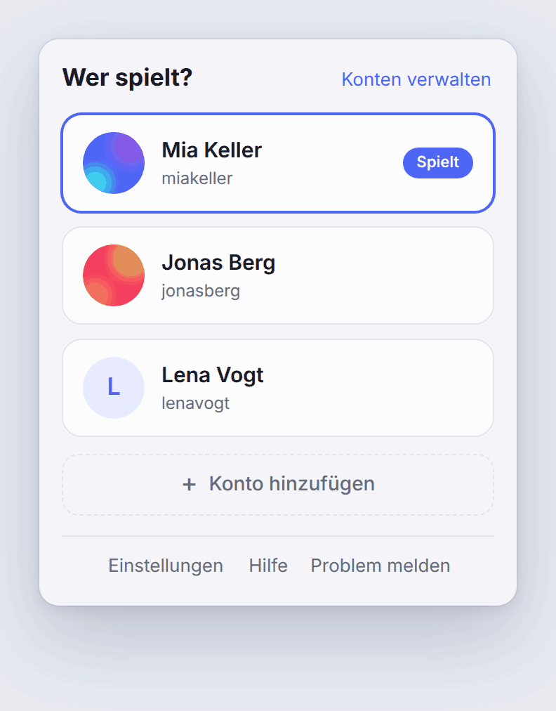
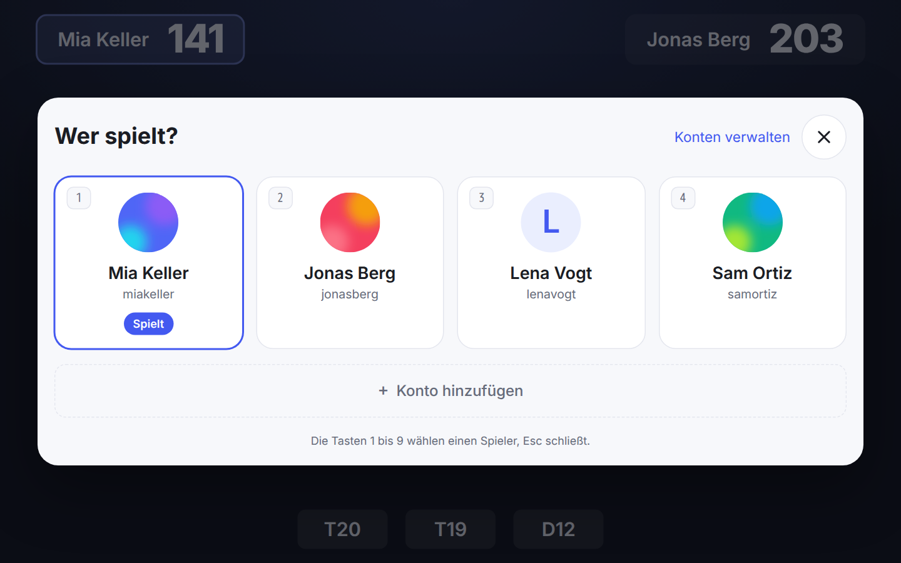
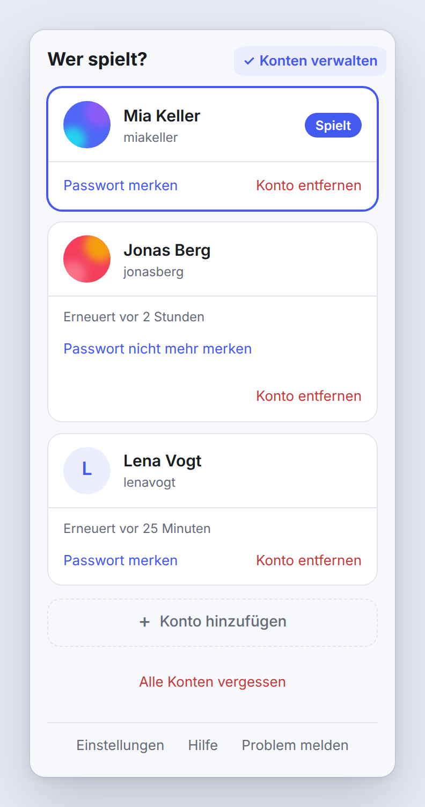

---
hide:
  - navigation
  - toc
---

# Player Switch for Autodarts

{ width="96" align="right" }

**Ein gemeinsames Autodarts-Display, jeder im eigenen Konto, ein Tipp zum Wechseln.**

Das Display im Flur, im Verein oder in der Kneipe teilen sich alle, aber jede Person spielt unter ihrem eigenen Autodarts-Konto. Die Erweiterung behält die Anmeldung jedes gespeicherten Kontos auf diesem Computer und wechselt mit einem einzigen Tipp: kein Passwort, keine Anmeldeseite, und das Konto, das Platz macht, ist sofort wieder da, sobald es jemand antippt.

[:material-download: Installieren](https://github.com/Dennis-Otto/player-switch-for-autodarts#quick-start){ .md-button .md-button--primary } [:material-monitor-dashboard: Display einrichten](shared-display.md){ .md-button } [:material-lifebuoy: Hilfe](help.md){ .md-button } [:material-shield-check: Sicherheitsdesign](security.md){ .md-button } [:material-file-document-outline: Datenschutz](privacy.md){ .md-button }

<picture>
  <source media="(prefers-color-scheme: dark)" srcset="images/switch.de.dark.gif">
  
</picture>

## Das kann die Erweiterung

- :material-gesture-tap:{ .lg .middle } **Ein Tipp, nichts tippen**

    ---

    Jedes Konto einmal speichern. Ein Tipp auf eine Kachel bringt das Konto aufs Board.

- :material-account-switch:{ .lg .middle } **Niemand wird abgemeldet**

    ---

    Das Konto, das Platz macht, bleibt geparkt angemeldet und kommt mit einem Tipp zurück.

- :material-autorenew:{ .lg .middle } **Auch Tage später bereit**

    ---

    Autodarts wechselt seine Sitzungs-Token regelmäßig; die Erweiterung erneuert jedes geparkte Konto im Hintergrund.

- :material-lock-outline:{ .lg .middle } **Privat von Grund auf**

    ---

    Alles bleibt im Browser auf diesem Computer und geht nur an Autodarts. Keine Statistiken, kein eigener Server.

## Warum nicht einfach … {#why-not-just}

- **… sich für jeden Spieler ab- und wieder anmelden?** Jeder Wechsel heißt, E-Mail und Passwort am Display einzutippen, oft auf einem Touchscreen vor allen anderen, und ein Konto, das sich mit Google oder Apple anmeldet, braucht dafür jedes Mal diesen Dienst und oft ein Handy. Mit Player Switch meldet sich jeder Spieler einmal an, und danach wechselt ein Tipp.
- **… jedem Spieler ein eigenes Chrome-Profil geben?** Jedes Profil ist ein eigenes Fenster, das einzeln eingerichtet und angemeldet bleiben muss, und zum Wechseln braucht es das Profilmenü von Chrome, das Vollbild und Kiosk-Modus ausblenden. Mit Player Switch sind die Spieler einen Tipp entfernt, direkt auf der Autodarts-Seite, in einem einzigen Fenster.
- **… die anderen als Gäste dazunehmen?** Das geht schnell, aber die Darts eines Gastes zählen für kein eigenes Konto: keine eigene Statistik und keine eigene Match-Historie. Mit Player Switch spielt jeder unter seinem eigenen Konto.

## Einrichten

Nach der Installation öffnet sich eine Willkommensseite mit drei Schritten:

1. **Symbol anheften.** Chrome legt eine neue Erweiterung hinter das Puzzleteil neben der Adressleiste: darauf klicken und dann auf die Nadel neben Player Switch for Autodarts.
2. **Den ersten Spieler anmelden**, auf [play.autodarts.com](https://play.autodarts.com). Das Konto wird von selbst gespeichert, und das Symbol zeigt kurz ✓.
3. **Weitere Spieler hinzufügen:** im Popup, oder bei den Spielern auf der Seite von Autodarts, **Konto hinzufügen** wählen und als nächste Person anmelden. Auch dieses Konto wird von selbst gespeichert, ohne das Popup noch einmal zu öffnen.

<picture>
  <source media="(prefers-color-scheme: dark)" srcset="images/diagrams/adding-a-player.de.dark.svg">
  
</picture>

Die Erweiterung speichert eine neue Anmeldung nur in den zehn Minuten nach **Konto hinzufügen** oder der Installation von selbst, nur einmal und nur, solange kein gespeichertes Konto spielt: Eine spätere Anmeldung wird nie ohne einen Tipp gespeichert. **Abbrechen** im Popup oder im Umschalter beendet das Warten früher. Ein `+` am Symbol heißt, dass jemand angemeldet ist, der noch nicht gespeichert ist, und **Konto speichern** im Popup speichert das Konto. **Hilfe** und **Problem melden** unten im Popup führen zur [Hilfe](help.md), die jede Meldung der Erweiterung erklärt, und zum Fehlerformular, in das sie nur die Versionen der Erweiterung und des Browsers eintragen.

## Am Board-Display

Ein Board-Display läuft oft im Vollbild oder als Kiosk, wo die Symbolleiste mit ihrem Popup nicht erreichbar ist. Darum trägt die Autodarts-Seite selbst einen runden Knopf in einer Ecke, mit dem Bild des Spielers. Ein Tipp darauf zeigt die Spieler über der Seite, in großen Kacheln für einen Touchscreen, mit allem, was das Popup kann.

- **Tastatur:** <kbd>Alt</kbd>+<kbd>Umschalt</kbd>+<kbd>O</kbd> öffnet und schließt die Spieler auf der Seite, <kbd>Alt</kbd>+<kbd>Umschalt</kbd>+<kbd>P</kbd> das Popup; die Tasten <kbd>1</kbd> bis <kbd>9</kbd> wählen einen Spieler und <kbd>Esc</kbd> schließt. Die Tastenkürzel änderst du unter `chrome://extensions/shortcuts`.
- **Ein Match endet nur mit Absicht:** Auf der Seite eines laufenden Matches fragt ein Wechsel vorher, bevor er einen Token verbraucht.
- **Deine Ecke:** **Einstellungen** im Popup blendet den Knopf aus oder setzt ihn in eine andere Ecke.
- **Privat:** Die Spieler öffnen sich in einer Seite der Erweiterung, in einem eigenen Rahmen, darum können die Skripte der Autodarts-Seite die gespeicherten Konten nicht lesen.

Die [Anleitung für ein gemeinsames Display](shared-display.md) richtet alles ein: den Kiosk-Modus, den Start mit dem Computer, eine Bildschirmtastatur für die Anmeldungen und die Energieeinstellungen, die jedes Konto bereit halten.

<picture>
  <source media="(prefers-color-scheme: dark)" srcset="images/switcher.de.dark.png">
  
</picture>

<picture>
  <source media="(prefers-color-scheme: dark)" srcset="images/diagrams/switch-from-the-page.de.dark.svg">
  
</picture>

## Mit Tastatur, Screenreader oder Finger {#accessibility}

- **Tasten auch im Popup:** Die Tasten <kbd>1</kbd> bis <kbd>9</kbd> wählen im Popup einen Spieler wie auf der Seite; ihre Nummern erscheinen auf den Kacheln, sobald du die Tastatur nutzt.
- **Der Fokus bleibt an seinem Platz:** Nach einem Wechsel bleibt er auf dem Spieler, der jetzt spielt, nach dem Entfernen springt er zur selben Aktion des Kontos an dessen Stelle, und **Abbrechen** führt dorthin zurück, wo du herkamst.
- **Klar für Screenreader:** Die Kachel des Spielers, der spielt, ist die aktuelle, **Konten verwalten** sagt, ob es an ist, die Aktionen unter einer Kachel tragen den Namen ihres Kontos, und ein Fehler wird sofort vorgelesen.
- **Gemacht für den Finger:** Jedes Bedienelement ist mindestens 44 mal 44 Pixel groß und kein Text kleiner als 12 Pixel; ein Kontrastdesign von Windows hält den Spieler, der spielt, und die Hinweise auseinander, und mit reduzierter Bewegung im System bewegt sich nichts.
- **Getestet:** Bei jeder Änderung öffnet ein Test das Popup in Chrome und prüft es mit [axe-core](https://github.com/dequelabs/axe-core), in allen fünf Sprachen und beiden Farbschemata, und geht jede Aktion allein mit der Tastatur durch.

## So funktioniert es

Autodarts Play speichert die Anmeldung als einen einzigen Wert im Browser, einen rotierenden Refresh-Token. Die Erweiterung behält diesen Wert pro Konto und tauscht ihn beim Wechsel.

<picture>
  <source media="(prefers-color-scheme: dark)" srcset="images/diagrams/switch-flow.de.dark.svg">
  
</picture>

- **Beim Wechseln** parkt sie die Sitzung des Kontos, das gerade spielte, schreibt die Sitzung des gewählten Kontos in die Seite und lädt neu.
- **Das Konto, das Platz macht, wird bei Autodarts nicht abgemeldet.** Seine Sitzung bleibt gültig; der Wechsel nimmt es nur von der Seite.
- **Geparkte Sitzungen werden frisch gehalten**, weil der Token rotiert: alle 12 Stunden, und gleich nach dem Start des Browsers, wenn der Computer aus war, als eine Erneuerung fällig war. „Konten verwalten“ zeigt bei jedem geparkten Konto, wann es zuletzt erneuert wurde, etwa „Erneuert vor 3 Stunden“, und solange Autodarts nicht erreichbar ist, seit wann das Erneuern nicht klappt; die Erweiterung versucht es alle 15 Minuten weiter.
- **Du siehst, wer sich kümmern muss.** Muss sich ein Konto neu anmelden, zeigt das Symbol in der Symbolleiste, wie viele es sind, und sein Tooltip nennt sie.
- **Eine Änderung nach der anderen.** Ein Token gilt nur einmal, deshalb zählt ein zweiter Tipp nicht, solange ein Wechsel läuft, und die Erneuerung im Hintergrund wartet, bis der Wechsel fertig ist. Ein Doppeltipp meldet den vorigen Spieler nicht ab.
- **Der Tab vorne.** Der Wechsel passiert im Autodarts-Tab, den du gerade siehst, und jeder andere Autodarts-Tab lädt mit dem neuen Spieler neu, damit keiner als der vorige weiterspielt. Ist kein Autodarts-Tab offen, öffnet ein Tipp Autodarts und wechselt dort.
- **Updates ohne Neuladen.** Chrome aktualisiert eine Erweiterung im Stillen, und eine Seite, die schon vorher offen war, bekommt dabei kein neues Skript. Die Erweiterung bringt ihr Skript nach jeder Installation und jedem Update in die offenen Autodarts-Tabs, und noch einmal in einen Tab, der beim Tippen nicht antwortet. So wechselt ein Display, das Autodarts tagelang offen hält, auch gleich nach einem Update, und ein laufendes Match geht weiter.
- **Passwort-Rückfall, optional.** Wenn du die Erweiterung ein Passwort merken lässt, meldet sie das Konto von selbst neu an, falls sein Token einmal nicht mehr geht. Konten, die sich mit Google oder Apple anmelden, können das nicht nutzen.

<picture>
  <source media="(prefers-color-scheme: dark)" srcset="images/manage.de.dark.png">
  
</picture>

Über Tage und Wochen wechselt ein gespeichertes Konto zwischen diesen Zuständen:

<picture>
  <source media="(prefers-color-scheme: dark)" srcset="images/diagrams/account-states.de.dark.svg">
  
</picture>

[Entscheidung 0002](decisions/0002-swap-the-session-not-the-login.md) hält fest, warum es so gebaut ist, und das [Sicherheitsdesign](security.md), was gespeichert wird und welche Risiken bleiben.

## Gut zu wissen

- Die Art, wie die Erweiterung eine Sitzung behält, ist keine offizielle Autodarts-Schnittstelle. Eine Änderung auf Seiten von Autodarts kann sie stoppen, bis die Erweiterung angepasst ist. Weist Autodarts alle gespeicherten Konten auf einmal ab, sagt das Popup das und verlinkt die bekannten Probleme und Updates: Dann lohnt sich ein Blick nach einem Update der Erweiterung, bevor sich alle neu anmelden.
- Sie ist für ein Display gebaut, das sich die Menschen eines Haushalts, Vereins oder Lokals teilen und dem sie vertrauen: Wer an diesem Display steht, kann zu jedem gespeicherten Konto wechseln.
- Die gespeicherten Sitzungen und gemerkten Passwörter liegen verschlüsselt, mit einem Schlüssel, den der Browser für die Erweiterung behält und nie herausgibt. Ein Werkzeug oder eine Kopie, die den Speicher der Erweiterung liest, findet darin keinen Token und kein Passwort.
- Die gespeicherten Konten tragen die Version ihres Formats. Wer zu einer älteren Version der Erweiterung zurückgeht, verliert die Konten nicht, die eine neuere gespeichert hat: Die ältere lässt sie unverändert, behält eine Kopie, und das Popup bittet um ein Update.
- Sie spricht Deutsch, Englisch, Niederländisch, Französisch und Spanisch, in der Sprache, in der Chrome läuft, und Englisch in jeder anderen. Die Hilfe und diese Website gibt es auf Deutsch und Englisch; **Hilfe** auf Niederländisch, Französisch oder Spanisch führt zur englischen Hilfe. [Eine Sprache hinzufügen](development.md#add-a-language) (auf Englisch) sagt, wie eine weitere dazukommt.
- Sie fragt nur nach dem Zugriff auf die Autodarts-Seiten, auf ihren eigenen Speicher, auf einen Timer für die Erneuerung und auf das Recht, nach einem Update oder in einem Tab, in dem es nicht mehr antwortet, ihr eigenes Skript in den Autodarts-Tabs auszuführen. Adresse und Titel deiner anderen Tabs und deinen Browserverlauf kann sie nicht lesen.

Nicht mit Autodarts verbunden.
