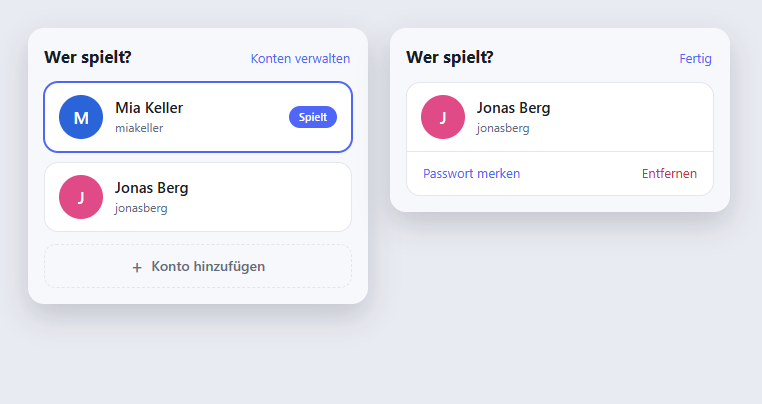

---
hide:
  - navigation
  - toc
---

# Player Switch for Autodarts

{ width="96" align="right" }

**One shared Autodarts display, everyone on their own account, one tap to switch.**

The display in the hallway, the club or the pub is shared, but everyone plays under their own Autodarts account. The extension keeps the sign-in of every saved account on that computer and swaps between them with a single tap: no password, no sign-in page, and the account that steps aside is ready again the moment someone taps it.

[:material-download: Install](https://github.com/Dennis-Otto/player-switch-for-autodarts#quick-start){ .md-button .md-button--primary } [:material-monitor-dashboard: Set up a display](shared-display.md){ .md-button } [:material-lifebuoy: Help](help.md){ .md-button } [:material-shield-check: Security design](security.md){ .md-button } [:material-file-document-outline: Privacy](privacy.md){ .md-button }

## What it does

- :material-gesture-tap:{ .lg .middle } **One tap, no typing**

    ---

    Save each account once. A tap on a tile puts that account on the board.

- :material-account-switch:{ .lg .middle } **Nobody gets signed out**

    ---

    The account that steps aside keeps its session parked, so a tap brings it straight back.

- :material-autorenew:{ .lg .middle } **Ready days later**

    ---

    Autodarts rotates its session tokens; the extension renews every parked account in the background.

- :material-lock-outline:{ .lg .middle } **Private by design**

    ---

    Everything stays in the browser on that computer and goes only to Autodarts. No analytics, no server of ours.

## Why not just … {#why-not-just}

- **… sign out and back in for every player?** Each change means typing an email and a password on the display, often on a touch screen in front of everyone, and an account that signs in with Google or Apple needs that service, and often a phone, each time. With Player Switch, each player signs in once, and from then on a tap switches.
- **… give every player a Chrome profile of their own?** Each profile is a window of its own, which has to be set up and kept signed in on its own, and switching takes the profile menu of Chrome, which fullscreen and kiosk mode hide. With Player Switch, the players are a tap away on the Autodarts page itself, in one window.
- **… add the others as guests?** Quick, but the darts of a guest count for no account of their own: no statistics and no match history of their own. With Player Switch, everyone plays under their own account.

## Set it up

After the install, a welcome page opens with three steps:

1. **Pin the icon.** Chrome puts a new extension behind the puzzle piece next to the address bar: click it, then the pin next to Player Switch for Autodarts.
2. **Sign in the first player** on [play.autodarts.com](https://play.autodarts.com). The account is saved by itself, and the icon shows ✓ for a moment.
3. **Add the next players:** in the popup, or in the players on the Autodarts page, choose **Add account** and sign in as the next person. That account is saved by itself too, without opening the popup again.

<picture>
  <source media="(prefers-color-scheme: dark)" srcset="images/diagrams/adding-a-player.dark.svg">
  
</picture>

The extension saves a new sign-in by itself only in the ten minutes after **Add account** or the install, only once, and only while no saved account plays: a sign-in later on is never saved without a tap. **Cancel** in the popup or the switcher stops the waiting earlier. A `+` on the icon says that someone is signed in who isn't saved yet, and **Save account** in the popup saves them. **Help** and **Report a problem** at the bottom of the popup lead to the [help](help.md), which explains every message of the extension, and to the bug form, which they fill in with the versions of the extension and the browser alone.

## On the board display

A board display often runs in fullscreen or as a kiosk, where the toolbar and its popup are out of reach. So the Autodarts page itself carries a round button in a corner, with the picture of the player. A tap on it shows the players over the page in large tiles for a touch screen, with everything the popup has.

- **Keyboard:** <kbd>Alt</kbd>+<kbd>Shift</kbd>+<kbd>O</kbd> opens and closes the players on the page, <kbd>Alt</kbd>+<kbd>Shift</kbd>+<kbd>P</kbd> the popup; the keys <kbd>1</kbd> to <kbd>9</kbd> pick a player and <kbd>Esc</kbd> closes. Change the shortcuts under `chrome://extensions/shortcuts`.
- **A match ends only on purpose:** on the page of a running match, a switch asks first, before it spends a token.
- **Your corner:** **Settings** in the popup turns the button off or moves it to another corner.
- **Private:** the players open in a page of the extension, in a frame of its own, so the scripts of the Autodarts page can't read the saved accounts.

The [guide for a shared display](shared-display.md) sets it all up: kiosk mode, the start with the computer, an on-screen keyboard for the sign-ins and the power settings that keep every account ready.

<picture>
  <source media="(prefers-color-scheme: dark)" srcset="images/diagrams/switch-from-the-page.dark.svg">
  
</picture>

## How it works

Autodarts Play keeps the signed-in session as a single value in the browser, a rotating refresh token. The extension keeps that value per account and swaps it when you switch.

<picture>
  <source media="(prefers-color-scheme: dark)" srcset="images/diagrams/switch-flow.dark.svg">
  
</picture>

- **Switching** parks the session of the account that was playing, writes the chosen account's session into the page and reloads.
- **The account that steps aside is not signed out at Autodarts.** Its session stays valid; switching away only takes it off the page.
- **Parked sessions are kept fresh**, because the token rotates: every 12 hours, and straight away after a start of the browser when the computer was off while a renewal was due. "Manage accounts" shows for each parked account when it was last renewed, such as "Renewed 3 hours ago".
- **You see who needs attention.** When an account has to sign in again, the toolbar icon shows how many, and its tooltip names them.
- **One change at a time.** A token works only once, so a second tap while a switch is on its way is ignored, and the renewal in the background waits for the switch. A double tap can't sign the previous player out.
- **The tab in front.** A switch happens on the Autodarts tab you're looking at, and every other Autodarts tab reloads with the new player, so none plays on as the one before. With no Autodarts tab open, a tap opens Autodarts and switches there.
- **Password fallback, optional.** If you let the extension remember an account's password, it signs that account back in by itself should its token ever stop working. Accounts that sign in with Google or Apple can't use this.

Over days and weeks, a saved account moves between these states:

<picture>
  <source media="(prefers-color-scheme: dark)" srcset="images/diagrams/account-states.dark.svg">
  
</picture>

[Decision 0002](decisions/0002-swap-the-session-not-the-login.md) records why it works this way, and the [security design](security.md) what it stores and the risks that remain.

## Good to know

- The way the extension keeps a session is not an official Autodarts interface. A change on Autodarts' side can stop it until the extension is adjusted. When Autodarts turns every saved account away at once, the popup says so and links to the known problems and updates, so you look for an update of the extension rather than sign everyone in again.
- It is built for a display that the people of a household, club or venue share and trust: anyone at that display can switch to any saved account.
- It asks only for access to the Autodarts sites, its own storage, a timer for the renewal and the right to run its own script in the Autodarts tabs after an update. It can't read the address or title of your other tabs, or your browsing history.

Not affiliated with Autodarts.
