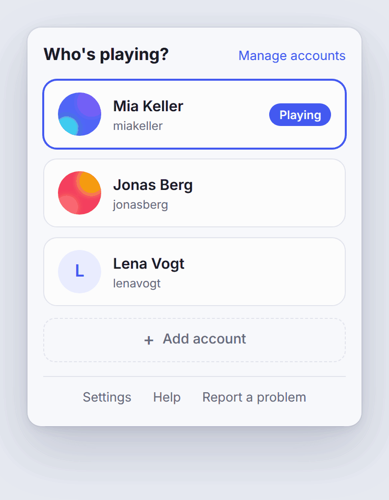
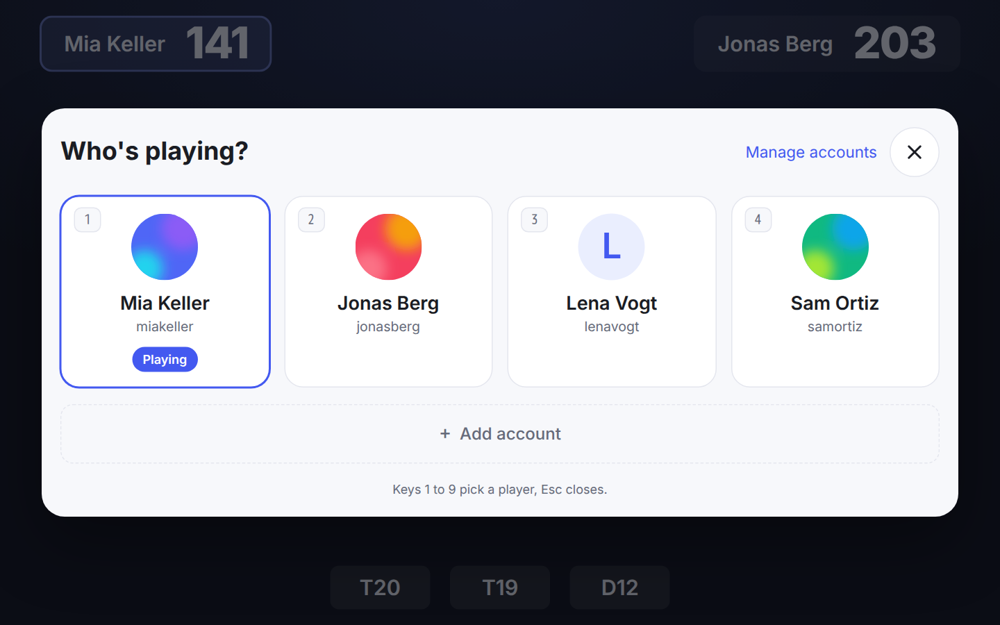
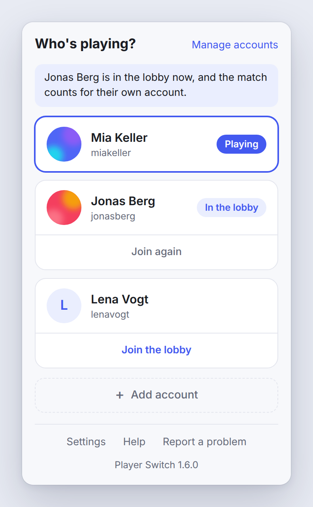
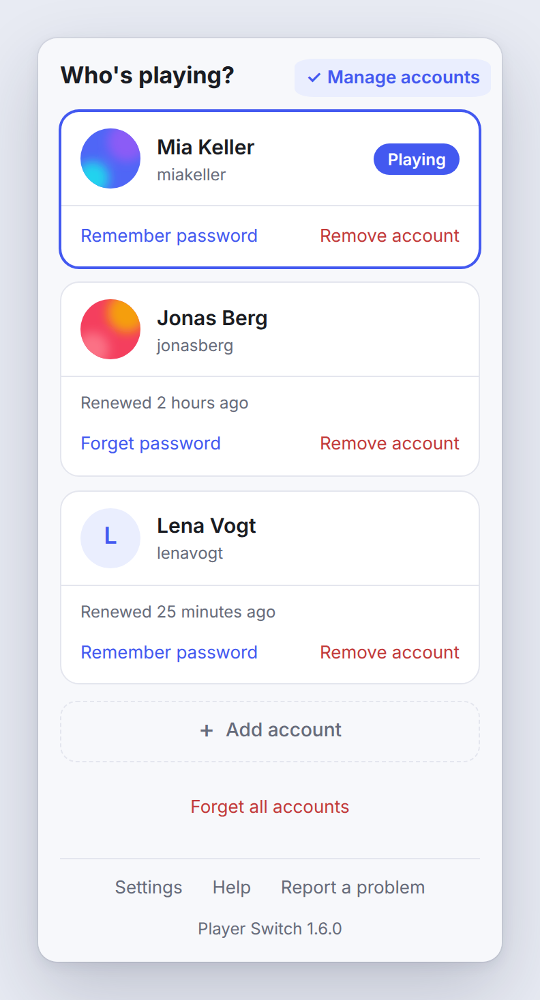
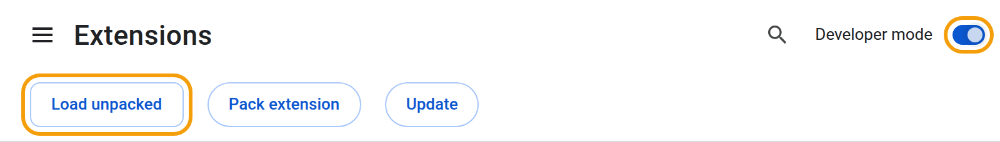

---
hide:
  - navigation
  - toc
---

# Player Switch for Autodarts

{ width="96" align="right" }

**One shared Autodarts display, everyone on their own account, one tap to switch.**

The display in the hallway, the club or the pub is shared, but everyone plays under their own Autodarts account. The extension keeps the sign-in of every saved account on that computer and swaps between them with a single tap: no password, no sign-in page, and the account that steps aside is ready again the moment someone taps it.

[:material-google-chrome: Add to Chrome](https://chromewebstore.google.com/detail/player-switch-for-autodar/gbijblgchbbbkjeibpjaodflfgbgefam){ .md-button .md-button--primary } [:material-download: Install without the store](#install-from-a-release){ .md-button } [:material-monitor-dashboard: Set up a display](shared-display.md){ .md-button } [:material-lifebuoy: Help](help.md){ .md-button } [:material-shield-check: Security design](security.md){ .md-button } [:material-file-document-outline: Privacy](privacy.md){ .md-button }

<picture>
  <source media="(prefers-color-scheme: dark)" srcset="images/switch.dark.gif">
  
</picture>

## What it does

- :material-gesture-tap:{ .lg .middle } **One tap, no typing**

    ---

    Save each account once. A tap on a tile puts that account on the board.

- :material-account-switch:{ .lg .middle } **Nobody gets signed out**

    ---

    The account that steps aside keeps its session parked, so a tap brings it straight back.

- :material-autorenew:{ .lg .middle } **Ready days later**

    ---

    Autodarts rotates its session tokens; the extension renews every parked account in the background.

- :material-lock-outline:{ .lg .middle } **Private by design**

    ---

    Everything stays in the browser on that computer and goes only to Autodarts. No analytics, no server of ours.

## Why not just … {#why-not-just}

- **… sign out and back in for every player?** Each change means typing an email and a password on the display, often on a touch screen in front of everyone, and an account that signs in with Google or Apple needs that service, and often a phone, each time. With Player Switch, each player signs in once, and from then on a tap switches.
- **… give every player a Chrome profile of their own?** Each profile is a window of its own, which has to be set up and kept signed in on its own, and switching takes the profile menu of Chrome, which fullscreen and kiosk mode hide. With Player Switch, the players are a tap away on the Autodarts page itself, in one window.
- **… add the others as guests?** Quick, but the darts of a guest count for no account of their own: no statistics and no match history of their own. With Player Switch, everyone plays under their own account.

## Set it up

After the install, a welcome page opens with four steps:

1. **Pin the icon.** Chrome puts a new extension behind the puzzle piece next to the address bar: click it, then the pin next to Player Switch for Autodarts. Edge and Firefox have the same puzzle piece: in Edge, click the eye instead of the pin, in Firefox the gear and then **Pin to Toolbar**.
2. **Sign in the first player** on [play.autodarts.com](https://play.autodarts.com). The account is saved by itself, and the icon shows ✓ for a moment.
3. **Add the next players:** in the popup, or in the players on the Autodarts page, choose **Add account** and sign in as the next person. That account is saved by itself too, without opening the popup again.
4. **Share the board.** Autodarts shows a board only to its owner and to the accounts that it is shared with, so the owner of the board shares it with every saved account: on Autodarts under **My Boards**, by the exact username, up to 10 other accounts. Otherwise a player sees no board after a switch, as [the help](help.md#board-not-shared) explains.

<picture>
  <source media="(prefers-color-scheme: dark)" srcset="images/diagrams/adding-a-player.dark.svg">
  
</picture>

The extension saves a new sign-in by itself only in the ten minutes after **Add account** or the install, only once, and only while no saved account plays: a sign-in later on is never saved without a tap. **Cancel** in the popup or the switcher stops the waiting earlier. A `+` on the icon says that someone is signed in who isn't saved yet, and **Save account** in the popup saves them. **Help** and **Report a problem** at the bottom of the popup lead to the [help](help.md), which explains every message of the extension, and to the bug form, which they fill in with the versions of the extension and the browser alone. Below them, and at the bottom of the players on the Autodarts page, stands which version runs on this display, such as *Player Switch 1.6.0*: Chrome fetches an update only every few hours, and [the help](help.md#which-version) says how to fetch it at once.

## On the board display

A board display often runs in fullscreen or as a kiosk, where the toolbar and its popup are out of reach. So the Autodarts page itself carries a round button in a corner, with the picture of the player. A tap on it shows the players over the page in large tiles for a touch screen, with everything the popup has.

- **Keyboard:** <kbd>Alt</kbd>+<kbd>Shift</kbd>+<kbd>O</kbd> opens and closes the players on the page, <kbd>Alt</kbd>+<kbd>Shift</kbd>+<kbd>P</kbd> the popup; the keys <kbd>1</kbd> to <kbd>9</kbd> pick a player and <kbd>Esc</kbd> closes. Change the shortcuts under `chrome://extensions/shortcuts`.
- **Any screen:** the tiles fit a monitor upright or across, at any zoom of the page. A few players share the width of the panel, and a long name or a long text in your language wraps onto the next line; nothing is cut off.
- **A match ends only on purpose:** on the page of a running match, a switch asks first, before it spends a token.
- **Your corner:** **Settings** in the popup turns the button off or moves it to another corner.
- **Private:** the players open in a page of the extension, in a frame of its own, so the scripts of the Autodarts page can't read the saved accounts.

The [guide for a shared display](shared-display.md) sets it all up: kiosk mode, the start with the computer, an on-screen keyboard for the sign-ins and the power settings that keep every account ready.

<picture>
  <source media="(prefers-color-scheme: dark)" srcset="images/switcher.dark.png">
  
</picture>

<picture>
  <source media="(prefers-color-scheme: dark)" srcset="images/diagrams/switch-from-the-page.dark.svg">
  
</picture>

## Two players, each with their own stats {#join-a-lobby}

Autodarts counts a match for each account that sits in its lobby, while the page plays under one account only. So the player on the page opens a lobby on Autodarts, at the board of the display, and the tile of every parked player, in the popup and in the players on the page, shows **Join the lobby**. A tap seats that player in the lobby, and the tile then says **In the lobby**.

- **No switch, no reload:** the page stays with the player who plays there, and the match counts for every player's own account, without a phone or a new sign-in.
- **Only on a lobby:** the tiles offer it only while the Autodarts tab shows a lobby, so a running match is never touched.
- **Join again:** the extension doesn't watch the lobby, so a tile goes on saying **In the lobby** after the host took that player out. **Join again** below it seats them once more, and changes nothing for a player who still sits there ([help](help.md#join-lobby)).
- **Private:** the extension seats the player with the session that it keeps parked for them, which never reaches the page ([decision 0016](decisions/0016-join-a-lobby-with-a-parked-session.md)).

<picture>
  <source media="(prefers-color-scheme: dark)" srcset="images/lobby.dark.png">
  
</picture>

<picture>
  <source media="(prefers-color-scheme: dark)" srcset="images/diagrams/join-a-lobby.dark.svg">
  
</picture>

## With a keyboard, a screen reader or a finger {#accessibility}

- **Keys in the popup too:** the keys <kbd>1</kbd> to <kbd>9</kbd> pick a player in the popup as they do on the page; their numbers show on the tiles once you use the keyboard.
- **The focus shows when you use the keys:** the players on the page start with the focus on the first tile. Its ring shows at once when you open them with the keyboard, and after a tap once you press a key, so a tap leaves the player who plays with one frame.
- **The focus keeps its place:** after a switch it stays on the player who plays now, after a removal it moves to the same action of the account in its place, and **Cancel** leads back to where you came from.
- **Clear to a screen reader:** the tile of the player who plays is the current one, **Manage accounts** says whether it is on, the actions below a tile carry the name of its account, and an error is read out at once.
- **Made for a finger:** every control is at least 44 by 44 pixels and no text is smaller than 12 pixels; a contrast theme of Windows keeps the player who plays and the chips apart, and with reduced motion in the system nothing moves.
- **Tested:** for every change, a test opens the popup in Chrome and checks it with [axe-core](https://github.com/dequelabs/axe-core), in all five languages and both color schemes, and walks through every action with the keyboard alone.

## How it works

Autodarts Play keeps the signed-in session as a single value in the browser, a rotating refresh token. The extension keeps that value per account and swaps it when you switch.

<picture>
  <source media="(prefers-color-scheme: dark)" srcset="images/diagrams/switch-flow.dark.svg">
  
</picture>

- **Switching** parks the session in the page with the account it belongs to, usually the one that was playing, writes the chosen account's session into the page and reloads. Only Autodarts can say whose a session is, so the extension renews it once as it leaves the page: a session that someone signed in with right on the page never lands on the tile of another player.
- **The account that steps aside is not signed out at Autodarts.** Its session stays valid; switching away only takes it off the page.
- **Parked sessions are kept fresh**, because the token rotates: every 12 hours, and straight away after a start of the browser when the computer was off while a renewal was due. "Manage accounts" shows for each parked account when it was last renewed, such as "Renewed 3 hours ago", and while Autodarts can't be reached, since when renewing it fails; the extension keeps trying every 15 minutes.
- **You see who needs attention.** When an account has to sign in again, the toolbar icon shows how many, and its tooltip names them.
- **One change at a time.** A token works only once, so a second tap while a switch is on its way is ignored, and the renewal in the background waits for the switch. A double tap can't sign the previous player out.
- **The tab in front.** A switch happens on the Autodarts tab you're looking at, and every other Autodarts tab reloads with the new player, so none plays on as the one before. With no Autodarts tab open, a tap opens Autodarts and switches there.
- **Updates need no reload.** Chrome updates an extension silently, and a page that was open before gets no new script by itself. The extension brings its script into the open Autodarts tabs after each install and update, and again into a tab that doesn't answer when you tap, so a display that keeps Autodarts open for days switches straight after an update, and a running match goes on.
- **Password fallback, optional.** If you let the extension remember an account's password, it signs that account back in by itself should its token ever stop working. Accounts that sign in with Google or Apple can't use this.

<picture>
  <source media="(prefers-color-scheme: dark)" srcset="images/manage.dark.png">
  
</picture>

Over days and weeks, a saved account moves between these states:

<picture>
  <source media="(prefers-color-scheme: dark)" srcset="images/diagrams/account-states.dark.svg">
  
</picture>

[Decision 0002](decisions/0002-swap-the-session-not-the-login.md) records why it works this way, and the [security design](security.md) what it stores and the risks that remain.

## Which browsers {#browsers}

- **Google Chrome 140 or newer**, and other browsers built on Chromium 140 or newer, such as Brave, Opera and Vivaldi, from [the Chrome Web Store](https://chromewebstore.google.com/detail/player-switch-for-autodar/gbijblgchbbbkjeibpjaodflfgbgefam), which brings every update on its own, or [from a release](#install-from-a-release).
- **Microsoft Edge 140 or newer** runs the same package: turn on **Allow extensions from other stores** under `edge://extensions` and install it from [the Chrome Web Store](https://chromewebstore.google.com/detail/player-switch-for-autodar/gbijblgchbbbkjeibpjaodflfgbgefam), or load it [from a release](#install-from-a-release). A listing in Edge Add-ons follows.
- **Firefox 153 or newer**, such as Firefox 153 ESR, runs the same package, linted with `web-ext lint` and tested in a real Firefox with every change, and every morning in Firefox 153 ESR and the next Firefox. It isn't listed on addons.mozilla.org: unzip [a release](#install-from-a-release) and load its `manifest.json` as a temporary add-on in `about:debugging`, which Firefox removes when it closes. Firefox grants the access to the two Autodarts sites as it loads the add-on, so there is nothing to allow: the add-on's page in `about:addons` shows it under **Permissions and data** as two switches, which stay on ([help](help.md#firefox-site-access)). The same page lists that the add-on sends authentication information, which goes to the sign-in service of Autodarts alone. Firefox can't keep the extension's storage from its script in the Autodarts page, so a display in a club or a pub runs Chrome or Edge: [the security design](security.md#firefox) says why. Firefox for Android is not tested.

## Install without the store {#install-from-a-release}

Every release carries the extension ready to load, the very file that goes to the Chrome Web Store. It needs no Node.js and no build:

1. Under **Assets** of the [latest release](https://github.com/Dennis-Otto/player-switch-for-autodarts/releases/latest), download `player-switch-for-autodarts-<version>.zip`.
2. Unzip it into a folder that stays, such as `Documents/Player Switch`: the browser reads the extension from there each time it starts.
3. Open `chrome://extensions`, or `edge://extensions` in Edge, turn on **Developer mode**, choose **Load unpacked** and pick that folder, the one with `manifest.json` in it.

<picture>
  <source media="(prefers-color-scheme: dark)" srcset="images/load-unpacked.dark.png">
  
</picture>

A copy loaded this way gets no update by itself, so a display does better with the store. For a new version, replace the contents of the folder with those of the new zip and choose the reload arrow of Player Switch on that page. Leave the folder where it is: the browser ties the saved accounts to its path, so a copy in another folder starts without them. The zip is the very file that goes to the Chrome Web Store, and [the release guide](releases.md#the-package-of-a-release) says how to check that a release built it. To move a display to the store, first remove this copy under `chrome://extensions`, then add Player Switch from the store and save the players again: the store copy has an id of its own and doesn't see the accounts of this one, and two copies at once would both keep the same sign-ins fresh.

## Good to know

- The way the extension keeps a session is not an official Autodarts interface. A change on Autodarts' side can stop it until the extension is adjusted. When Autodarts turns every saved account away at once, or refuses the renewal itself, the popup says so and links to the known problems and updates, so you look for an update of the extension rather than sign everyone in again.
- It is built for a display that the people of a household, club or venue share and trust: anyone at that display can switch to any saved account. Where not everyone knows everyone, the [venue mode](shared-display.md#venue-mode) adds a manager PIN, a PIN per player and a return to a house account after a break, never during a match.
- The saved sessions and remembered passwords are stored encrypted, with a key that the browser keeps for the extension and never hands out. A tool or a copy that reads the storage of the extension finds no token and no password in it.
- **Remove account** ends the session of the account at Autodarts before it deletes it, so no copy of it keeps working, and **Forget all accounts** under **Manage accounts** does so for every account and wipes the extension before a display changes hands. Removing the extension alone signs nobody out at Autodarts: [the help](help.md#forget-all) says more.
- The saved accounts carry the version of their format. Going back to an older version of the extension never wipes accounts that a newer one saved: the older one leaves them untouched, keeps a copy, and the popup asks you to update.
- It speaks English, German, Dutch, French and Spanish, in the language that Chrome runs in, and English in any other. The help and this website are in English and German; **Help** in Dutch, French or Spanish leads to the English help. [Add a language](development.md#add-a-language) says how another one comes in.
- It asks only for access to the Autodarts sites, its own storage, a timer for the renewal and the right to run its own script in the Autodarts tabs after an update, or in a tab where it stopped answering. It can't read the address or title of your other tabs, or your browsing history.
- What comes in the next twelve months, and what won't, is in the [roadmap](roadmap.md).

## Also for your board {#homedarts}

[**HomeDarts for Autodarts**](https://dennis-otto.github.io/homedarts-for-autodarts/), by the same author, brings your Autodarts board into Home Assistant: every dart live and local from the Board Manager in your network, scoreboards for any screen, statistics, and automations such as lights that follow the game. Each works without the other: Player Switch needs no Home Assistant, and HomeDarts needs no browser extension.

Not affiliated with Autodarts.
