# A shared display

A board display in the hallway, the club or the pub: a computer by the board, a screen that everyone reaches, and Chrome with Autodarts. This guide sets it up so that every player plays under their own account and a tap switches players, also in fullscreen and kiosk mode, and so that the display starts by itself and stays ready for days.

<picture>
  <source media="(prefers-color-scheme: dark)" srcset="images/diagrams/display-setup.dark.svg">
  
</picture>

## What you need

- **A computer by the board** with Google Chrome on Windows, macOS or Linux, or a Raspberry Pi with Raspberry Pi OS and its Chromium.
- **A screen in reach of the players**, best a touch screen; a mouse or a small wireless keyboard works too.
- **An Autodarts account for every player**, and a browser profile for the display: one of its own, not anyone's personal one. The extension keeps the accounts in that profile.

## 1. Save the players {#save-the-players}

Install the extension from the Chrome Web Store, or unpacked as the [quick start](https://github.com/Dennis-Otto/player-switch-for-autodarts#quick-start) shows. A welcome page opens with three steps: pin the icon, sign in the first player, and add the next ones. [Set it up](index.md#set-it-up) on the home page shows them.

Each player signs in once: choose **Add account**, and the next sign-in on Autodarts is saved by itself. Save every player before you turn on kiosk mode, while the keyboard and the toolbar are at hand; **Add account** in the players on the Autodarts page works in kiosk mode too.

## 2. Choose how players switch {#how-players-switch}

- **The icon in the toolbar**, pinned, for a display that shows the browser as usual. A tap on it opens the players.
- **The button on the Autodarts page**, a round button in a corner with the picture of the player. A tap on it shows the players over the page, in large tiles for a touch screen. In fullscreen and kiosk mode, it is the way to switch. **Settings** in the popup moves it to the corner where it covers nothing that you need on Autodarts, or turns it off.
- **The keyboard:** <kbd>Alt</kbd>+<kbd>Shift</kbd>+<kbd>O</kbd> opens and closes the players on the page, the keys <kbd>1</kbd> to <kbd>9</kbd> pick a player, and <kbd>Esc</kbd> closes them. Change the shortcut under `chrome://extensions/shortcuts`.

## 3. Fullscreen or kiosk mode {#fullscreen-or-kiosk}

**Fullscreen** hides the toolbar and the tabs: <kbd>F11</kbd> on Windows and Linux, <kbd>Control</kbd>+<kbd>Command</kbd>+<kbd>F</kbd> on a Mac, and the same keys leave it again.

**Kiosk mode** starts Chrome on one page, without the address bar, tabs or menus, and nobody at the display can leave it by accident. Start it with this command, on Windows with the full path of Chrome:

```text
"C:\Program Files\Google\Chrome\Application\chrome.exe" --kiosk https://play.autodarts.com
```

On a Raspberry Pi, the command is `chromium --kiosk https://play.autodarts.com`; on Raspberry Pi OS Bookworm and older, Chromium is `chromium-browser`. <kbd>Alt</kbd>+<kbd>F4</kbd> ends kiosk mode.

- **Close every Chrome window first.** A Chrome that runs already opens a normal window and ignores `--kiosk`.
- **The profile of the display:** with more than one Chrome profile on the computer, add `--profile-directory="Profile 1"` with the name of its folder, which `chrome://version` shows as the last part of the *Profile path*.
- **No incognito, no guest:** never add `--incognito` or `--guest`. Chrome runs no extension in a guest window, and the saved accounts belong to the normal profile.

## 4. Start with the computer {#autostart}

### Windows

1. Press <kbd>Win</kbd>+<kbd>R</kbd>, type `shell:startup` and press <kbd>Enter</kbd>: the folder of the programs that start when this Windows user signs in opens.
2. Right-click in it, choose **New → Shortcut**, and enter the command of kiosk mode above as its location.
3. Name it, such as *Autodarts*, and choose **Finish**.

Chrome then starts in kiosk mode each time this user signs in. A display that should come back by itself after a power cut also needs a Windows user that signs in without a password prompt.

### Raspberry Pi OS

Create the file `~/.config/autostart/autodarts.desktop` with these lines; the desktop starts it each time it starts, on Raspberry Pi OS with Wayland as with X11:

```ini
[Desktop Entry]
Type=Application
Name=Autodarts
Exec=chromium --kiosk https://play.autodarts.com
```

On Raspberry Pi OS Bookworm and older, write `chromium-browser` in place of `chromium`. **Auto login**, under **Raspberry Pi Configuration → System**, signs in to the desktop by itself, so the display comes back after a power cut.

## 5. Type on a touch screen {#on-screen-keyboard}

Only the sign-ins need a keyboard: once per player, and again only when a tile says **Sign in again**.

- **Windows 11:** under **Settings → Time & language → Typing → Touch keyboard**, let Windows show the touch keyboard when no keyboard is attached; it then opens as soon as you tap a field.
- **Raspberry Pi OS** brings an on-screen keyboard for a touch screen, which **Raspberry Pi Configuration** turns on and off.
- **Or a small wireless keyboard,** put away again after the sign-ins.

When Chrome offers to save a password on the display, choose **Never**: the extension needs no password, and anyone at the display could use a saved one. After a sign-in with Google or Apple, sign out of Google or Apple in this browser again; the [help](help.md#google-or-apple) says why.

## 6. Keep it ready {#keep-it-ready}

The extension renews every parked session every 12 hours, while the browser runs. While the computer sleeps, no renewal runs, and Chrome runs the one that was due as the computer wakes; after the computer was off, the extension renews straight away as the browser starts. How long a session lasts without a renewal is up to Autodarts.

- **A display that runs every day** needs nothing more.
- **A display that is off for days,** such as at a club that plays once a week: turn it on now and then in between, or let the accounts with an Autodarts password remember it, so that they sign in again by themselves. Any other account that has to sign in again shows **Sign in again**, and the [help](help.md#sign-in-again) says what to do.
- **The screen may turn off** whenever it likes: the renewal needs only the computer and the browser. Set the power options of Windows so that the computer doesn't sleep while it is plugged in, and let only the screen turn off. A Raspberry Pi doesn't sleep; **Screen Blanking** under **Raspberry Pi Configuration → Display** only turns the screen off.

## 7. In a club or pub: the venue mode {#venue-mode}

At home, everyone at the display may play under any saved account, which is the point. In a club or a pub, not everyone at the board knows everyone else. The venue mode, under **Settings** → **For a club or pub**, adds three locks for the people at the display. Each one is off until you turn it on.

<picture>
  <source media="(prefers-color-scheme: dark)" srcset="images/diagrams/venue-mode.dark.svg">
  
</picture>

- **A manager PIN** guards **Manage accounts**, where accounts are removed and passwords remembered or forgotten, and the settings themselves. The popup and the players on the Autodarts page ask for it once as **Manage accounts** opens, and forget it as it closes.
- **A PIN for each player who wants one,** 4 to 8 digits, under **PINs of the players**. A tap on that player's tile asks for it, on a number pad that works on a touch screen, before anything changes; their tile shows a lock. Nobody else plays under their account and spoils their statistics.
- **Return after a break:** after 5 to 60 minutes without a tap, a click or a key on the Autodarts page, the display switches to a house account of your choice, or signs out, so that the next games don't count for the player who left. A match is never interrupted: the break starts once it has ended. The player before keeps their session parked, so a tap brings them back.

Five wrong PINs in a row lock every PIN of the display for a minute, so that nobody tries them all by hand. The extension keeps no PIN, only a salted hash of it.

A PIN is a lock for the people at the display, not a protection against someone who can use the computer: whoever can open `chrome://extensions` can remove the extension, and a program that reads the profile of the browser can try every 4-digit PIN against its hash. The [security design](security.md#venue-mode) says more.

### A forgotten manager PIN {#forgotten-manager-pin}

The manager PIN can't be read anywhere. Someone who can use the computer turns the venue mode off, and the accounts stay:

1. Open `chrome://extensions` and turn on **Developer mode** at the top right.
2. Under **Player Switch for Autodarts**, choose **service worker** next to *Inspect views*.
3. In the **Console** of the window that opens, type `chrome.storage.local.remove("venue")` and press <kbd>Enter</kbd>.

Every PIN is gone then, and the display no longer returns after a break: set them again under **Settings**.

## 8. Before the first evening {#checklist}

- [ ] A tap on each tile switches to that player, and **Manage accounts** shows no **Sign in again**.
- [ ] The button on the Autodarts page sits in a corner where it covers nothing that you need.
- [ ] Chrome saves no password on this display, and nobody is still signed in to Google or Apple in it.
- [ ] After a restart of the computer, Chrome comes back by itself, in kiosk mode on Autodarts.
- [ ] The computer doesn't sleep, or it wakes often enough for the renewal.
- [ ] Everyone knows the rule: change players with a tile, never with a sign-out on Autodarts, which ends a session for good.
- [ ] In a club or pub: the manager PIN is set and known to the people who run the display, and every player who wants a PIN has one.

## 9. When the display changes hands {#changes-hands}

Before the computer is sold, given away or leaves the club, open **Manage accounts** and choose [**Forget all accounts**](help.md#forget-all), while Autodarts can be reached. It signs every saved account out at Autodarts, the player on the page too, and deletes all that the extension keeps, with the key that seals the sessions, the PINs and the settings. Removing the extension alone signs nobody out at Autodarts. A player who leaves the club for good is removed the same way, one account at a time, with **Remove account**.

Not working as it should? The [help](help.md) explains every message of the extension.
